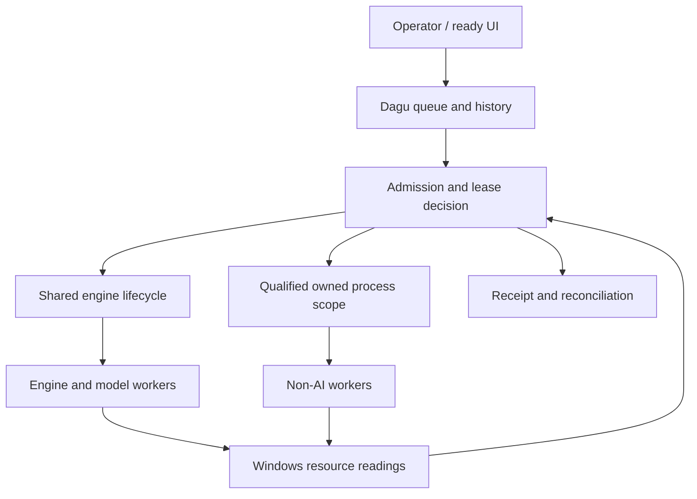
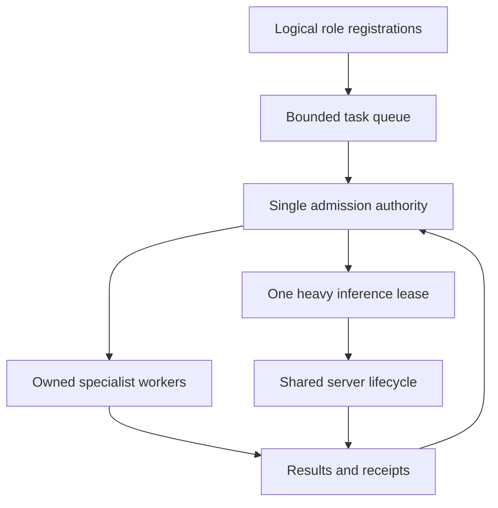

# A0011 — Resource-Control Foundation Decision Dossier for Windows 11

request_id: Q0011  
response_id: A0011  
research_date: 2026-10-20 UTC  
status: RESEARCH COMPLETE / DOCUMENTARY EVIDENCE / NOT DEVICE-VALIDATED / NOT ADOPTED  
accepted baseline read: Applied CURRENT v0.46  
existing receipt: PERSISTENCE-VERIFIED-APPLIED004-BRIDGEQ0010-V046  
General Discovery: independent Discovery054 / CURRENT v52; no General TECH IDs assigned  
authorized output: this new responses/A0011.md only

## 1. نتیجهٔ اصلی برای تصمیم‌گیری

**اول باید دربارهٔ محیط مدیریت منابع تصمیم گرفت؛ انتخاب همیار، مدل و کاربرد اولین کار نیست.** در این بررسی هیچ نرم‌افزار نصب‌شده‌ای امتیاز نگرفت. ابزار تازه‌کشف‌شده نیز به‌خاطر تازگی برتر محسوب نشد. هیچ نصب، اجرای مدل، آزمون لپ‌تاپ، ساخت همیار، تغییر ویندوز یا تغییر Notion انجام نشده است.

قابلیت‌های لازم در نرم‌افزارهای آماده وجود دارند، اما در چند بخش متفاوت: مشاهدهٔ RAM و CPU؛ محدودیت کرنلی برای فرایندهای تحت مالکیت؛ صف و سابقهٔ کار؛ و بارگذاری و تخلیهٔ مدل. **در منابع بررسی‌شده محصول رایگان واحدی اثبات نشد که همهٔ این‌ها را با پذیرش کار بر اساس RAM قابل‌استفاده و commit، حفظ پاسخ‌گویی مرورگر، توقف ایمن در شکستِ اعمال محدودیت و بازیابی قابل‌اعتماد یکپارچه کند.** این نتیجه دربارهٔ دامنهٔ بررسی است، نه ادعای نبودن چنین محصولی در جهان.

سه مسیر واقعاً قابل‌دفاع باقی می‌ماند:

1. **کمترین پیچیدگی و بدون کدنویسی جدید:** R0، ابزارهای خود ویندوز + یک موتور درخواستی و صف تحت نظارت انسان. مناسب برای شروع مدیریت دستی؛ فاقد تضمین مدیریت خودکار چند کار.
2. **بیشترین استفاده از ابزار آماده:** R1، Dagu Community برای صف/سابقه/رابط + Process Governor از lowleveldesign برای محدودیت فرایند + یک موتور مشترک + نمایشگر آماده هنگام نیاز. هماهنگ‌سازی دقیق و سیاست پذیرش هنوز آماده و تضمین‌شده نیست؛ «کمی تنظیمات» با «مدیر منابع کامل» تفاوت دارد.
3. **کنترل مرکزی خودکار با کمترین ساخت ضروری:** پس از تأیید نیاز، یک لایهٔ کوچک سیاست/lease و اتصال به ابزار آماده؛ اگر مسیر آماده نتواند شروط شکست ایمن را برآورده کند، R2 یا R3 با Job API بومی. C#/.NET برای یکپارچگی ویندوز و رابط بومی قوی‌تر است؛ Go برای بسته‌بندی CLI مناسب است؛ **برتری مصرف RAM هیچ‌یک روی این دستگاه اندازه‌گیری نشده**. ساخت پلتفرم کامل از صفر توجیه نشده است.

یافته‌های تعیین‌کننده:

- Dagu واقعاً روی Windows Job Object برای سقف CPU و commit دارد. اما اسناد و کد نسخهٔ v2.21.0 اعمال محدودیت را best-effort می‌دانند: شکست می‌تواند فقط هشدار بدهد و کار ادامه یابد. کد مدیریت چرخه هم Job با kill-on-close دارد، ولی اتصال پس از شروع و مسیر تنزل‌یافته دارد. بنابراین هم «Dagu هیچ مهار بومی ندارد» نادرست است و هم «Dagu به‌تنهایی fail-closed کامل است».
- Process Governor از lowleveldesign ابزار CLI آماده، MIT و دارای شروع فرایند در Job است. کد انتشار 4.1.26190 تخصیص Job هنگام ایجاد و شروع suspended را نشان می‌دهد. اما kill-on-close در مسیر تنظیم محدودیت بررسی‌شده دیده نشد؛ Ctrl-C با حالت مناسب با مرگ ناگهانی مدیر برابر نیست. استفاده از آن نیاز به ساخت دوبارهٔ همهٔ APIهای محدودیت را کم می‌کند، نه اینکه کل سیاست و مالکیت عمر کار را خودکار حل کند.
- نسخهٔ رایگان Process Lasso محدودکنندهٔ CPU، watchdog و چند قابلیت مهم دیگر را پس از دورهٔ آزمایشی تأمین نمی‌کند؛ استفادهٔ تجاری هم مجوز می‌خواهد. SmartTrim سقف commit یا آزادسازی کامل مدل نیست.
- llama.cpp router پیش‌فرض تا چهار مدل هم‌زمان اجازه می‌دهد. خواب می‌تواند مدل و KV را آزاد کند ولی worker را نگه دارد. تخلیهٔ صریح router مسیر متفاوتِ پایان worker دارد. یک endpoint مساوی یک فرایند نیست.
- Lemonade مدیریت منابع مدل پیشرفته‌تری از برداشت سادهٔ A0010 دارد: LRU بر اساس نوع، idle/VRAM eviction اختیاری، pinning و نمایش منابع. اما سقف یک مدل **برای هر نوع** است؛ routing helper هم pool جدا دارد. نرم‌افزار حاضر اثبات‌کنندهٔ یک lease سراسری برای همهٔ کارهای AI و غیر AI نیست.
- llama-swap علاوه بر جابه‌جایی موتورهای ناهمگون، در کد Windows نسخهٔ v265 Job با kill-on-close برای درخت خود دارد. این مزیت واقعی است؛ RAM admission، سقف CPU/commit و صف عمومی کارها را از آن نتیجه نمی‌گیریم.
- روی لپ‌تاپ، 8GiB نصب‌شده با حدود 5.88GiB قابل‌مشاهده برای OS فرق دارد. UMA از همان RAM مصرف می‌کند. هیچ «بهینه‌ساز RAM» این محدودیت را از بین نمی‌برد. بهینه‌سازی مؤثر بیشتر از جلوگیری از بارگذاری اضافی، صف‌بندی و پایان کارگرهای بیکار به‌دست می‌آید.

**هیچ معماری انتخاب یا مجاز به اجرا نشده است.** فاصلهٔ امتیازها، زمان توسعه و مصرف واقعی سیستم مجهول است. تصمیم بعدی باید دامنهٔ خودکارسازی مدیر و معیار پذیرش آن را مشخص کند، نه اولین همیار را.

## 2. Authority, preflight and evidence method

### 2.1 Actual project sources read

The Bridge is a mailbox, not a second canonical capability library. The coordinator alone reviews and catalogs findings in the original Notion Applied pages. The current report does not declare Applied v0.47 or acceptance.

| Actual source | Identity / version read | Meaning for this report |
|---|---|---|
| [README](../README.md) | blob 2cf909c65cc02924418cd7f6bdc209bc337cb14a | Create the matching new response; fetch it fully; never overwrite an exchange |
| [Q0011](../requests/Q0011.md) | blob 5b6d2dd9a767f6ae024232ff8af5e0e342188025; 21,199 characters | Resource manager first; documentary research only |
| [Q0010](../requests/Q0010.md) | blob b3e2116494b8f0051f51075542b79c788fe4a670 | Previous, wider Windows technology question |
| [A0010](A0010.md) | full file, 133,883 characters; blob 0da1a1c978e8dec1c84f776bb92c46736acc0e0c | Prior evidence, not a binding architecture |
| [A0007](A0007.md), [A0008](A0008.md), [A0009](A0009.md) | full fetched reports; relevant catalog/resource/security findings reviewed | Reuse verified context without repeating the whole agent catalog |
| [Persistent Operating Memory](https://app.notion.com/p/3edc8c684690814a9707cb880534f462) | edited 2026-10-19 22:41:08.992Z | Independent neutral discovery |
| [Tool Governance](https://app.notion.com/p/3edc8c68469081cc90abdd5183f1bdb1) | edited 2026-10-17 16:40:34.103Z | Tool authority and boundaries; newer explicit neutrality rules govern |
| [Applied Mission](https://app.notion.com/p/3fdc8c6846908167a77feab9564dc66d) | edited 2026-10-20 11:31:01.612Z | Central resource environment before individual assistants |
| [Applied Capability Index](https://app.notion.com/p/3fdc8c684690817a9b5acef3c108253f) | CURRENT v0.46; edited 2026-10-20 11:05:33.404Z | A0010 accepted with qualifications; receipt above |
| [Windows Roadmap](https://app.notion.com/p/3fcc8c684690813a82b3d0ce909534e3) | edited 2026-10-20 11:31:04.153Z | Latest resource-control priority supersedes earlier assistant-first sequencing |
| [Windows Journal](https://app.notion.com/p/3fbc8c6846908184b4bbe32c586686e3) | edited 2026-10-19 15:46:04.025Z | Historical user-executed device evidence, not new measurements |
| [Continuity](https://app.notion.com/p/3eec8c684690815f9731dceea916137a) | edited 2026-10-20 11:31:06.115Z | Q0011 dispatch commit dc0424fe4b26b3f660d31396419db11f3924429e |
| [General Discovery](https://app.notion.com/p/3fbc8c684690817d8c94cce0bfaa1a59) | independent Discovery054 / CURRENT v52; page edited 2026-10-18 | No Applied-to-General promotion or ID assignment |

Final pre-write refresh found Q0011 unchanged and the Mission, Applied v0.46, Roadmap and Continuity edit timestamps unchanged from the readings above. A0011 was still absent immediately before creation.

Native page fetches were retained with their returned metadata. No exposed truncation or unknown-block warning was used as if it were complete missing evidence. Large console displays can truncate; full fetched content and specific relevant passages were used. Earlier historical instructions that stopped at Q0010 are superseded by the actual latest Q0011 dispatch and this user's instruction.

All 17 Applied branches remain catalog classifications. They do not imply 17 resident processes, 17 model copies or any deployment. The historical Shared Brain / Research Architect project supplies no inherited foundation.

### 2.2 Evidence labels

- **D:** official documentation or license explicitly states a capability.
- **S:** specific official source code inspected; interpretation is source-level, not a runtime certification.
- **H:** historical reading performed by the user and recorded in the journal.
- **I:** engineering inference or proposed decision rule.
- **U:** unknown without official evidence or separately authorized device proof.

All external retrievals in this round occurred on **2026-10-20 UTC**. Release publication dates are separately recorded. A current default-branch README is not automatically a property of an older released binary. Important source paths were cross-checked against release tags where stated. Release assets were inspected as metadata only; none were downloaded or executed.

A dependency count is an architectural count, not a measured process count. A binary's disk/download size, source line count, programming language or marketing claim of “lightweight” is not idle RAM evidence.

### 2.3 Explicit revisions to A0010

| A0010 position or unresolved question | A0011 correction / refinement |
|---|---|
| B5/Dagu scored 84 and native .NET path 81 in the earlier scenario | Those weights included assistant/workflow needs. They cannot select a manager-first foundation. New weights, hard gates and implementation-risk qualifications are used below |
| The minimum host depended on the first assistant's task | First define host resource truth, ownership, admission, operator control and recovery even with no assistants or models installed |
| A ready governor can reduce custom low-level work | Confirmed for limits and process launch, but crash semantics, named monitoring, quoting, ownership and failed assignment must be inspected; no blanket replacement guarantee |
| Dagu was promising for scheduling | Its Windows enforcement is real, but documented best-effort and post-start assignment are material gaps for strict fail closure; lifecycle Job and resource Job are distinct scopes |
| Job notifications were useful for completion | Most completion-port notifications are not guaranteed; reconcile with accounting. A Job handle is not a universal “all children finished” event |
| Sleep/unload were differentiated | Now source-qualified: sleeping worker can survive; router explicit unload stops the child. Process exit and actual whole-system reclamation still require proof |
| One model at a time as a policy | Preserve as a global heavy-work lease, not an inference-server default. Per-type and helper pools can defeat a simplistic count |
| No proven language footprint winner | Remains true. Native AOT, self-contained distribution and browser-free UI must be compared as packaging choices, not measured memory ranks |
| Installation history was context | Remains inventory only; Jan/Python/SQLite/Ollama or any installed product gets zero selection bonus |

## 3. Device envelope and what can actually be optimized

### 3.1 Historical facts, with their limits

| Item | Evidence and interpretation |
|---|---|
| Machine | Lenovo 81W1 / IdeaPad 3 15ADA05 family; Windows 11 Pro; Ryzen 5 3500U / Vega 8 |
| CPU | Vendor family specification lists 4 cores / 8 threads for 3500U. Logical threads are not eight independent physical cores |
| RAM installed | 8GiB physically installed, H |
| OS-visible RAM | About 5.88GiB, H; not the physical module total |
| Hardware reserved | About 2.1GiB, H; journal GPU/UMA observations explain the major reservation |
| Ordinary availability | Historically about 2–3GiB, H; variable, not a guaranteed task budget |
| Commit snapshot | Approximately 4.3–4.66 / 7.5GiB at recorded moments, H; not a fixed future limit |
| Pagefile | Automatic; roughly 1664MiB then allocated, H; allocation at one moment is not its maximum growth |
| GPU memory | Roughly 2GiB preallocated UMA comes from system RAM. Shared GPU capacity around 2.9GiB is a limit, not an additional up-front reservation or discrete VRAM |
| Driver / BIOS history | Journal records driver 31.0.21024.2004 and BIOS E8CN34WW, 2022-04-28. No update/check was executed in this round |
| Exact present load and thermal state | U. Historical snapshots do not establish today's idle or sustained performance |

[Lenovo PSREF](https://psref.lenovo.com/syspool/Sys/PDF/IdeaPad/IdeaPad_3_15ADA05/IdeaPad_3_15ADA05_Spec.pdf), pp. 2–3, lists for Ryzen/Athlon variants one soldered memory bank plus one SO-DIMM slot and an offered 12GB arrangement, 4GB+8GB. This is a plausible **future hardware branch**, conditional on exact machine/part/support confirmation. It does not mean both CIM memory devices are replaceable slots, prove arbitrary larger modules supported, or authorize purchase, opening the chassis or changing firmware. No vendor-approved exact UMA adjustment procedure was established.

### 3.2 Resource truth a central interface must preserve

| Quantity | Official Windows basis | Correct use / common error |
|---|---|---|
| Installed memory | Hardware inventory / physically installed memory information | Capacity inventory, not currently allocatable memory |
| OS-visible physical total | GlobalMemoryStatusEx.ullTotalPhys / PERFORMANCE_INFORMATION.PhysicalTotal | Host resource denominator; differs from installed RAM |
| Available physical | ullAvailPhys / PhysicalAvailable | Standby+free+zero pages immediately reusable without first writing to disk; do not require Free alone to be high |
| System commit | GetPerformanceInfo CommitTotal and CommitLimit, in pages multiplied by PageSize | Distinct from resident physical pages; inspect current headroom and its trend |
| Process private commit | PROCESS_MEMORY_COUNTERS_EX.PrivateUsage; PagefileUsage also denotes commit charge | “PagefileUsage” is misleading as a label: it is not bytes physically stored in the paging file |
| Working set / peak working set | PROCESS_MEMORY_COUNTERS_EX.WorkingSetSize / PeakWorkingSetSize | Resident process pages, including shareable pages; not all private allocations |
| Shared/mapped pages | Working-set and mapped-file documentation; RAMMap | Summing all process working sets can double count shared pages; low private commit can coexist with significant model residency |
| File cache / standby | Windows memory lists; RAMMap | Useful reclaimable cache, not automatically waste or a leak |
| Kernel and driver memory | PERFORMANCE_INFORMATION kernel pools, native tools | Host consumption outside the managed worker tree matters |
| Faults | Per-process PageFaultCount includes soft faults; memory/disk counters and Resource Monitor add context | All faults are not disk paging. Hard faults can read mapped files, not just pagefile |
| GPU budget/use | DXGI QueryVideoMemoryInfo gives a process's budget/current usage per segment | Not a universal physical-host free-memory meter; UMA, driver allocations and browser GPU work must be considered |
| CPU | System and owned-process time deltas / PDH | State whether normalized to all logical processors; single-core percentages differ by tool |
| Frequency/power/thermal | Windows QoS/performance evidence plus supported vendor readings | A CPU cap is not a guaranteed temperature, battery life or throughput |

Primary references: [MEMORYSTATUSEX](https://learn.microsoft.com/en-us/windows/win32/api/sysinfoapi/ns-sysinfoapi-memorystatusex), [PERFORMANCE_INFORMATION](https://learn.microsoft.com/en-us/windows/win32/api/psapi/ns-psapi-performance_information), [PROCESS_MEMORY_COUNTERS_EX](https://learn.microsoft.com/en-us/windows/win32/api/psapi/ns-psapi-process_memory_counters_ex), [Memory Performance Information](https://learn.microsoft.com/en-us/windows/win32/memory/memory-performance-information), [Working Set](https://learn.microsoft.com/en-us/windows/win32/procthread/process-working-set), [DXGI](https://learn.microsoft.com/en-us/windows/win32/api/dxgi1_4/nf-dxgi1_4-idxgiadapter3-queryvideomemoryinfo).

Do not use ullTotalPageFile as disk pagefile capacity. Microsoft defines it as the smaller of the system or current-process commit limit. For global commit headroom, GetPerformanceInfo's system counters are the appropriate basis.

**Commit controls and physical residency solve different problems.** A Job commit cap can reject new private committed allocations and cause application OOM; it does not reserve physical pages for the browser, account perfectly for shared mapped weights, or bound every GPU/driver allocation. A task may page heavily well before commit exhaustion. Conversely, a large commit figure does not mean every committed byte occupies RAM now.

### 3.3 Effective reclamation versus cosmetic reduction

| Action | What can improve | What it cannot promise |
|---|---|---|
| Do not start an unnecessary GUI/worker/model | Avoids allocation and startup bursts altogether | Exact saved amount without before/after whole-machine evidence |
| Queue heavy work instead of running parallel copies | Reduces overlapping peaks, thread competition and KV duplication | Safe fit of a single unknown job |
| Share one model server among logical roles | Avoids separate full stacks when compatible | Automatic permission isolation or one worker solely because URL is shared |
| Engine unload | Releases backend model/context resources according to implementation | Immediate increase by model file size in Free RAM; OS cache may remain |
| Exit owned worker tree | Releases its private allocations, handles and mappings; GPU driver release may lag | Removal of all cached file pages or other processes' mappings |
| Trim working set | Moves pageable residency away from a process | Lower private commit or lower total virtual allocation; can increase refaults |
| Suspend/freeze process | Reduces executing CPU work | Frees commit, safely releases locks, or unloads GPU/model state |
| Compression managed by Windows | Trades some CPU for reduced physical storage of suitable pages | A fixed amount of additional RAM or zero overhead |
| Automatic pagefile | Supports commit and eviction of suitable pages | Physical RAM speed, adequate disk space or guaranteed growth timing |

Keep Windows compression and the automatic pagefile as observed. Do not purge standby memory, force working-set trimming, disable memory services or change BIOS as a default “optimization”. [Microsoft's pagefile explanation](https://learn.microsoft.com/en-us/troubleshoot/windows-client/performance/introduction-to-the-page-file) explains the commit and paging roles; it is not evidence that disk memory matches RAM performance. A report's safe policy is to avoid the pressure rather than make Windows appear emptier.

### 3.4 Observability with bounded overhead

Ready observation should precede a new permanent metrics stack. Task Manager, Resource Monitor and Performance Monitor already cover physical/commit/process/disk/CPU perspectives. Process Explorer or System Informer can be opened for deeper inspection. RAMMap is a physical-page diagnostic, not a continuously needed controller.

For a later small host, prefer a few retained native queries and owned-process handles, modest periodic sampling, and event-triggered refresh. Microsoft's memory resource notifications supply system low/high physical-memory signals with a neutral band; they are **not** task-specific budgets or commit-exhaustion signals. Combine them with explicit counters and stale-data handling.

[PDH](https://learn.microsoft.com/en-us/windows/win32/api/pdh/nf-pdh-pdhcollectquerydata) supports query reuse and successive samples; individual counter status still needs checking even when the batch call succeeds. Rate counters need a valid interval. Counter instance names/PIDs can change; PID plus creation time/handle matters. Do not spawn PowerShell/CIM and enumerate every property at every UI refresh. CIM is useful for infrequent inventory, not an assumed cheapest high-rate loop.

[ETW](https://learn.microsoft.com/en-us/windows/win32/etw/event-tracing-portal) is valuable for targeted diagnosis and attribution. Always-on stack capture, verbose tracing and full system handle scans are unnecessary foundation costs. .NET PerformanceCounter is a wrapper around counter infrastructure, not a separate low-overhead guarantee.

**No reputable comparable idle/peak benchmark for these complete bundles on this laptop was located. All such MB/CPU figures remain U.** A low-frequency design is an overhead-reduction inference, not a measured saving or permission to start a sampler.

## 4. Native control and independently compared ready Windows products

### 4.1 What the OS can enforce

[Job Objects](https://learn.microsoft.com/en-us/windows/win32/procthread/job-objects) are the native process-group mechanism. They can carry accounting, CPU-rate control and memory/other limits; nested jobs exist on modern Windows. A Job is not a security sandbox. Access to files, credentials and network still follows process identity and separate permissions.

For strict owned-worker launch, create/configure the scope before useful execution, assign at creation or while suspended, verify success, and only then permit execution. Attaching after launch leaves an escape window; finding descendants later is a fallback, not equivalent containment. Child propagation has exceptions, including breakaway policies and work launched indirectly through another service or WMI. An engine already running independently is not captured merely because a client sends it HTTP requests.

[Extended limit information](https://learn.microsoft.com/en-us/windows/win32/api/winnt/ns-winnt-jobobject_extended_limit_information) defines aggregate/per-process committed-memory limits. Hard cap, OOM outcome and graceful cancellation must be distinguished. [CPU rate control](https://learn.microsoft.com/en-us/windows/win32/api/winnt/ns-winnt-jobobject_cpu_rate_control_information) can cap a Job, while priority gives relative scheduling preference. Affinity restricts eligible processors; CPU Sets can be preferences. [EcoQoS](https://learn.microsoft.com/en-us/windows/win32/procthread/quality-of-service) expresses energy/performance preference. None alone implements admission, fairness or memory reclamation.

Kill-on-close means **closing the last applicable Job handle** can terminate associated processes when the flag is set. Handle inheritance/duplication changes who keeps that Job alive. It is not implied by every Job wrapper. A Job wait becoming signaled is documented for time-limit events; empty-job accounting must be checked. Most completion-port messages are not guaranteed, apart from specified notification-limit guarantees: use event hints plus reconciliation, not a single infallible event.

Normal same-user owned-process control can often avoid elevation, subject to access rights and existing jobs. Do not claim every operation works unelevated: protected/elevated targets, privilege-sensitive working-set controls and service registration are separate. Raising priority, enabling debug privilege or running as SYSTEM is not required merely to manage a child process.

### 4.2 Ready candidate comparison: identity and actual scope

| Product / current evidence | Actual role and interface | Real limits / lifecycle | Gaps and decision |
|---|---|---|---|
| **Windows Task Scheduler** | Built-in GUI, COM API, ScheduledTasks interface; triggers, task history and task-instance policies | Per-task Queue / IgnoreNew / Parallel / StopExisting; account/session, battery/idle and timeout conditions | Not a global memory admission scheduler. Different tasks can overlap; stopping a task is not proof an external engine tree ended. R0 baseline |
| **lowleveldesign/process-governor** | MIT CLI; C# library source, named-job monitor/IPC; latest release **4.1.26190, 2026-07-08**, GitHub marks latest release non-prerelease; service mode itself documented beta | Job private-commit caps per process/aggregate, CPU hard rate, affinity, priority, wall/user time; recursive propagation optional; launch/attach modes | Best ready hard-limit wrapper here. No global queue/admission/dashboard. Crash ownership unresolved without an outer fail-closed owner. Do not conflate package release status with beta service status |
| **Bitsum Process Lasso** | Proprietary GUI plus governor component, rule import/export/INI/CLI surfaces | Priority, affinities/CPU Sets, ProBalance; CPU Limiter changes affinity; separate hard-throttling feature | CPU Limiter, Hard Throttling, Watchdog, instance limits etc. are trial/Pro. Commercial deployment needs license within 30 days. Not the genuinely free governance core |
| **Prohect/ProcGovernor** | Distinct Rust project, **3.0.0, 2026-08-23**, CC0; rule-based service/console | Core/thread selection, priority, I/O/memory page priority, Job affinity features | Not the lowleveldesign tool; “memory priority” is not memory commit cap. Hybrid P/E-core features do not provide special 3500U benefit. CPU-policy alternative, not full foundation |
| **SystemXFiles/process-governor** | Distinct Python rules/GUI, **v1.3.1, 2025-04-19**, GPL-3.0 | Automatic process-priority, I/O-priority and affinity rules | README requests Administrator; no verified aggregate commit/admission contract. Extra runtime/rules for weaker fit; not preferred |
| **BES** | Portable per-process CPU limiter; **1.7.10 stable**, 1.8.0.39 test; GPL-2.0 | Suspension/resumption or debug-based CPU throttling | No RAM control or durable queue. Suspending lock/IO holders can stall dependent work. Narrow manual troubleshooting option |
| **System Informer** | Native graphical process/service/resource inspection; MIT; official si-builds latest **4.0.26255.346, 2026-09-12** | Rich process/handle/resource views and operator actions | Excellent optional observer; not documented general admission/lease API. Driver/elevation-dependent depth is optional and not silently authorized |
| **Process Explorer** | Microsoft Sysinternals portable observer; official page updated **2026-10-15** | Tree, handles/modules and process/performance inspection | Sysinternals EULA, not OSS; no verified durable resource scheduler. Optional troubleshooting UI |
| **RAMMap** | Sysinternals physical-memory categorization/snapshots; **v1.63, 2026-03-26** | Explains page/file-cache residency | Diagnostic, not a queue/governor. Its purge actions are not recommended policy. Download size is not resident RAM |
| **TaskExplorer** | Qt GUI; **v2.0.1, 2026-10-12**; GPL-3.0; Windows and Linux source | Detailed CPU/memory/process/Job views; Windows implementation uses Process Hacker/System Informer-derived support and custom driver | New broad observer comparison, not proven automatic global controller. Linux helper privilege claims cannot be transferred to Windows. GUI+driver complexity can be omitted |
| **TrafficMonitor Lite** | Taskbar CPU/RAM/network display; **V1.86, 2026-03-29** | Quick visible utilization; Lite avoids standard hardware-sensor elevation requirement | Anti-996 License, not MIT/GPL. No commit admission, queue, permission or engine semantics. Optional convenience, not enough for manager UI |
| **Dagu Community** | Go native binary/server, CLI, REST and browser UI; **v2.21.0, 2026-10-18**, GPL-3.0-or-later | Named queues, limits on concurrent runs, state/history/retry/stop; Windows Job implementations inspected below | Strong ready workflow coordinator. Resource enforcement best-effort; no demonstrated host-wide adaptive RAM lease |
| **Shawl** | Rust Windows service wrapper, **v1.9.0, 2026-05-03**, MIT; CLI | Service lifecycle, restart policy, logs; Ctrl-C then forced termination; descendant cleanup documented | A maintained service-wrapper alternative discovered beyond A0010. Does not supply CPU/RAM admission or operator approvals. Optional later only |
| **WinSW** | XML + wrapper service CLI, MIT; latest stable **v2.12.0, 2023-01-28**; 3.x prereleases separate | Service start/stop/restart/log configuration | Packaging/runtime support varies by asset. A new major prerelease is not stable support proof. Useful only if a service is required |
| **NSSM** | Public-domain service wrapper | Service/process restart and control | Official stable **2.24 (2014)** and highlighted pre-release **2.24-101 (2017)**; current Windows 11 assurance not established. Lower confidence than a maintained qualified alternative |

Sources: [Task Scheduler instance policies](https://learn.microsoft.com/en-us/windows/win32/taskschd/taskschedulerschema-multipleinstancespolicy-settingstype-element), [lowleveldesign README](https://github.com/lowleveldesign/process-governor), [release](https://github.com/lowleveldesign/process-governor/releases/tag/4.1.26190), [Bitsum Free vs Pro](https://bitsum.com/process-lasso-free-vs-pro/), [Bitsum licensing](https://bitsum.com/apps/process-lasso/docs/deployment/licensing/), [Bitsum CPU Limiter](https://bitsum.com/apps/process-lasso/docs/algorithms/cpu-limiter/), [Prohect](https://github.com/Prohect/ProcGovernor), [SystemXFiles](https://github.com/SystemXFiles/process-governor), [BES](https://mion.yosei.fi/BES/), [System Informer](https://github.com/winsiderss/systeminformer), [official builds](https://github.com/winsiderss/si-builds/releases/latest), [Process Explorer](https://learn.microsoft.com/en-us/sysinternals/downloads/process-explorer), [RAMMap](https://learn.microsoft.com/en-us/sysinternals/downloads/rammap), [TaskExplorer](https://github.com/DavidXanatos/TaskExplorer), [TrafficMonitor](https://github.com/zhongyang219/TrafficMonitor), [Shawl](https://github.com/mtkennerly/shawl), [WinSW](https://github.com/winsw/winsw), [NSSM downloads](https://nssm.cc/download).

TrafficMonitor's README predates some release changes: V1.86 adds GPU/disk utilization to Lite. “Lite” must not be paraphrased as having no GPU information of any kind. Its lack of complete management semantics remains unchanged.

**Process-name ambiguity:** Bitsum also uses the phrase/process name “process governor”. It is not lowleveldesign, Prohect or SystemXFiles. A future package pin must include owner/repository, release asset, license and hash, not just “install ProcGovernor”.

### 4.3 Deep source inspection: does procgov remove the need for a custom low-level supervisor?

Specific release-tag source was read, not just feature names:

- [Win32ProcessModule.cs, 4.1.26190](https://github.com/lowleveldesign/process-governor/blob/4.1.26190/procgov-lib/Win32ProcessModule.cs), blob **86e2e39873f72351b64df86e41bd16480d90f889**: normal StartProcessInJob uses PROC_THREAD_ATTRIBUTE_JOB_LIST plus CREATE_SUSPENDED, then settings and resume. This is stronger than launching an unrestricted child then discovering it later. The separate with-token path has different mechanics; this report does not generalize the normal path's guarantees to every launch mode.
- [Win32JobModule.cs](https://github.com/lowleveldesign/process-governor/blob/4.1.26190/procgov-lib/Win32JobModule.cs): CPU hard-cap and committed-memory flags are real. When propagation is disabled it sets SILENT_BREAKAWAY_OK; recursive behavior must therefore be intentional. Its completion wait also polls ActiveProcesses rather than relying solely on Job signaling.
- [Program_CmdApp.cs](https://github.com/lowleveldesign/process-governor/blob/4.1.26190/procgov/Program_CmdApp.cs): Ctrl-C has distinct “terminate Job” and “leave process running” behavior. Termination is an explicit code path; arbitrary manager crash is not equivalent.
- No KILL_ON_JOB_CLOSE flag was found in the inspected Job-settings path. The instance's Dispose closes handles; closing a non-kill Job handle does not force its live processes to end. This is a **negative source finding limited to the paths inspected**, not an exhaustive security audit.
- Named jobs launch/reuse a second monitor; README says at most one per Windows session and it should exit after its last monitored process. Anonymous and named jobs have different update/lifetime behavior.
- The CLI constructs a command string from target arguments. Exact quoting of empty strings, embedded quotes and unusual paths must be qualified for a future adapter; a general shell string from untrusted task text is inappropriate.
- Library source exposes ProcessGovernorInstance, Win32JobModule and monitor IPC types. A user/elevated SID-based pipe-name distinction is visible. This is not proof of a stable separately packaged SDK, correctly restricted pipe ACLs or a supported general-purpose external RPC contract.
- The current project file targets net10.0-windows8.0, x64 and PublishAot=true. This is packaging/source evidence, not an assurance that every asset needs no dependencies or has a particular idle footprint.

**Answer:** Existing procgov can avoid rewriting limit-setting and much ordinary owned-process launch code. It does **not** eliminate the need to decide admission, own leases, reconcile engine workers, handle crash containment and verify argument/security behavior. Prefer using its published CLI as a separate program if it passes the required contract. Only implement missing native control if a qualified ready outer owner/adapter cannot close the gap. Do not adopt its beta SYSTEM service to avoid thinking about this.

### 4.4 Deep source inspection: what Dagu already supplies and what remains

Official [DAG Run Resource Limits](https://docs.dagu.sh/writing-workflows/dag-run-resource-limits) says failure to apply limits produces a warning and execution continues. The v2.21.0 code confirms rather than contradicts this:

| Inspected source | Finding | Consequence |
|---|---|---|
| [resourcelimit/native_windows.go](https://github.com/dagucloud/dagu/blob/v2.21.0/internal/runtime/resourcelimit/native_windows.go), blob 01bfee631c14f5a541bf1bfbfb127ce4a704b6ae | Job aggregate memory flag and CPU ENABLE+HARD_CAP; CPU millicores converted relative to runtime.NumCPU | Genuine kernel control, not just UI. The memory limit is Windows commit semantics, not a reserved physical-RAM budget |
| [resourcelimit/guard.go](https://github.com/dagucloud/dagu/blob/v2.21.0/internal/runtime/resourcelimit/guard.go), blob b65d96541471de37486fded42035c1b8b83be5c2 | Start deliberately never returns an enforcement error; warning/result instead | A high safety requirement needs explicit refusal outside this default |
| [command.go](https://github.com/dagucloud/dagu/blob/v2.21.0/internal/runtime/builtin/command/command.go), blob 253804735691fb6a53543ab8f6cafc9cee75164a | StartManagedProcess precedes resource-guard assignment; assignment error is logged, not fatal | No strict pre-execution resource admission guarantee |
| [cmdutil/lifecycle_windows.go](https://github.com/dagucloud/dagu/blob/v2.21.0/internal/cmn/cmdutil/lifecycle_windows.go), blob 986fcc4b3decad2487814ebceaf674be51919225 | Separate lifecycle Job sets KILL_ON_JOB_CLOSE; afterStart assigns process; failure marks degraded and returns nil; stop prefers TerminateJobObject, then tree fallback | Good real cleanup functionality. Post-start window and degraded fallback still matter |
| [cmdutil/lifecycle.go](https://github.com/dagucloud/dagu/blob/v2.21.0/internal/cmn/cmdutil/lifecycle.go), blob 866608e270596c7ce5afd30e3549f9fa3de3cbd1 | cmd.Start occurs before afterStart; parent-exit watcher added; Wait waits root | Root completion, descendant lifetime and guard coverage need reconciliation |
| [Queue Assignment](https://docs.dagu.sh/writing-workflows/queues), [Queue Configuration](https://docs.dagu.sh/server-admin/queues) | Shared named queues and concurrency slots for scheduled/enqueued runs | Configure all relevant entrants through a common route later; per-DAG default concurrency one is not a global one-heavy-job guarantee |

Dagu can already supply workflow structure, visible queued/running/failed state, filesystem-backed history and basic operator control. Do not create a new scheduler, graph editor or database server just to reproduce those functions. Its optional browser/AI/MCP/cloud/distributed features are not foundation requirements.

However, a queue concurrency count is not adaptive admission based on live host memory, commit headroom, unknown peaks and foreground reserve. An external model daemon reached by an HTTP step is outside the step's child tree unless separately owned. Nested Jobs can cooperate, but compatibility across Dagu's lifecycle/resource jobs and an external governor must be proved, not assumed. Wrapping everything in multiple governors can add conflicts and obscure ownership.

**Minimum missing layer for strict automatic R1:** a single serialized admission/lease decision, refusal on failed containment, exact engine lifecycle adapter, ownership reconciliation, and a small consolidated status/receipt view if two ready windows are unacceptable. This is a meaningful policy adapter, not a claim of zero work or a ready-made feature.

### 4.5 Where the manager should live

| Location | Suitable use | Tradeoff / disposition |
|---|---|---|
| **On-demand ordinary user-session process** | Human present; no work needed while logged out; core currently idle | Strong initial candidate. No new idle resident controller when not needed; ordinary child rights; explicit stop still needs owned-tree semantics |
| **User-session tray/CLI host while logged in** | Later accepted background queue and operator status | Good conditional automatic host. Tray UI optional; login start requires separate approval; logoff/reboot ends session and requires reconciliation |
| **Ready user daemon** | Dagu or inference manager that already supplies needed controls | Avoid duplicating it. Closing a browser/GUI need not stop daemon; identify actual process owner |
| **Windows service under least-privilege identity** | Only a demonstrated need for work before login / independent of user session | Service registration, account/ACL and session-0 UI separation add cost. Never assume SYSTEM or always-admin |
| **WSL service/container** | A genuinely necessary Linux-only component later | Additional host/guest boundary; cannot govern all native Windows processes by guest policy |
| **Separately powered LAN host** | Future real always-on requirement | Different deployment/permission decision. A sleeping/off laptop is not an always-available service |

Windows Task Scheduler can provide approved launch triggers without a bespoke startup service. “Run whether logged on or not” changes identity/session/UI/credential behavior; a foreground desktop tool does not become safely interactive in session 0. Restart-on-failure must be bounded and side-effect aware. Sleep/resume invalidates timing assumptions; on resume, re-read resources and reconcile before admitting new work. Powered off means all local services are off.

## 5. Shared inference lifecycle: ready capabilities before another manager

No weights, model, default context or benchmark winner is selected. CPU-native feasibility and documented Windows binaries matter more than unsupported claims of Ryzen AI acceleration: this 3500U/Vega machine is not evidence of a modern Ryzen AI NPU platform.

### 5.1 Engine comparison

| Engine / manager | Documented lifecycle and interface | Process / memory implications | Missing from a central resource manager |
|---|---|---|---|
| **llama.cpp server / router, v0.7.0, 2026-10-15** | Native C++; health/props/metrics; router models list and POST /models/load, /models/unload; models-max default **4**, autoload enabled; sleep-idle-seconds default **disabled** | Single-model server versus router parent+model children are different. mmap weights, KV/context, batch buffers and backend allocations have different costs | No global foreground reserve, generic job queue, approval ledger or cross-program RAM lease |
| **Ollama v0.40.6, 2026-10-16** | CLI/API; /api/ps; keep_alive controls unload, zero unloads, negative keeps resident; request value can override server default | Manager and model runners; parallelism/context affect resident allocation. Built-in queue is inference-specific; default residency can persist after request | Need control of client overrides, global lease and non-AI work. Current release notes explicitly fix orphaned Windows runners: pinning matters |
| **LM Studio / llmster; desktop 0.4.26** | lms CLI + documented REST load/unload/status; headless daemon independent of GUI; JIT/TTL/Auto-Evict | JIT Auto-Evict default on, at most one JIT-loaded model; non-JIT loads excluded. JIT TTL default 60 minutes; lms explicit loads lack TTL unless set | Not full host-memory admission. Closing GUI or minimizing to tray does not establish no daemon/model residency |
| **Jan Desktop v0.8.7, 2026-10-20** | Desktop local API/runtime and GUI; prior A0010 documented explicit model management and security defaults | Desktop frontend/runtime may remain even when model unloads. Existing install gets no advantage | No documented complete general job/admission/lease host. Its agent/shell features are outside this request |
| **Lemonade v2026.42.1, 2026-10-14** | Native server + CLI/API; load/unload/health/system-stats/config; multiple backends; optional GUI | max_loaded_models default **1 per type**, helper pool separate; pinning; opt-in idle/VRAM eviction. Backend dependency graph can include more than C++ | Host commit and RAM admission for all programs not established. GPU-pressure policy is not global CPU/UMA physical-memory governance |
| **KoboldCpp v1.123.1, 2026-10-13** | Native Windows package and embedded web UI, GGUF serving | Can be a simple on-demand single workload; added modalities/options change memory | No verified unified cross-program lease/durable management plane; packaging convenience is not resource-control completeness |
| **llama-swap v265, 2026-10-14** | MIT Go proxy+web UI; starts/swaps compatible upstream commands; TTL and manual unload APIs; status/log UI | Basic mode one model; advanced matrix/persistent groups permit multiple. Proxy+upstream workers; Windows child cleanup below | Best reason is heterogeneous engine lifecycle, not adding a second manager around a server that already suffices |

Sources: [llama.cpp tagged server documentation](https://github.com/ggml-org/llama.cpp/blob/v0.7.0/tools/server/README.md), [Ollama FAQ](https://docs.ollama.com/faq), [Ollama release](https://github.com/ollama/ollama/releases/tag/v0.40.6), [LM Studio headless](https://lmstudio.ai/docs/developer/core/headless), [TTL / Auto-Evict](https://lmstudio.ai/docs/developer/core/ttl-and-auto-evict), [LM Studio download/version](https://lmstudio.ai/download), [Jan release](https://github.com/janhq/jan/releases/tag/v0.8.7), [Lemonade multi-model](https://github.com/lemonade-sdk/lemonade/blob/v2026.42.1/docs/guide/configuration/multi-model.md), [Lemonade API](https://github.com/lemonade-sdk/lemonade/blob/v2026.42.1/docs/api/lemonade.md), [KoboldCpp](https://github.com/LostRuins/koboldcpp), [llama-swap](https://github.com/mostlygeek/llama-swap).

Jan's detailed local-API discussion here is inherited source-qualified A0010 evidence, not a claim that the failed jan.ai/docs/local-api URL was successfully read today. Current v0.8.7 release notes also mention shell-tool behavior; those agent tools must not be enabled merely to supply inference.

### 5.2 Source-level lifecycle distinctions that change the shortlist

**llama.cpp.** Tagged README blob **4e4472ec24bd0822be30e327aecd549cc15a2bc8** and newer master README blob **e1c5804da5c275aa856f40f6e4f4b1b1acb93731** were read. The v0.7.0 [server-models.cpp](https://github.com/ggml-org/llama.cpp/blob/v0.7.0/tools/server/server-models.cpp), blob **60353240ac9121242b4139fa6688570c1a4a0a5f**, was fetched alongside master **606eab4f4a428b551e028f559b9aad2906d691f0**. Newer source is not silently treated as a released guarantee.

Sleep mode is not process suspension: server support can release loaded model/KV resources and later reload. Source explicitly treats a sleeping child as still running. Router unload requests child exit, monitor tracks exit and force-termination deadlines, while the parent remains. Therefore show **model unloaded**, **worker exited**, and **host headroom recovered** as three separate observations. Monitoring endpoints documented as non-waking should be used rather than a fake inference ping that defeats idle release. No second llama-swap is mandatory if this router's lifecycle is enough.

**Lemonade.** Release-tag multi-model guide blob **628ebc0a1789c9828f7b030f519a036cfda8014e** documents independent type pools and routing-helper residency. Default one does not constrain the total to one. Dynamic eviction is opt-in, default off; its soft downsize is backend-specific and explicitly a no-op for llama.cpp in that guide. Full eviction leaves weight files potentially cached by the OS. Pinned/busy models constrain eviction.

Current [Windows metrics source](https://github.com/lemonade-sdk/lemonade/blob/main/src/cpp/server/platform/metrics_windows.cpp), blob **9eae790212f0a3ab6f58e947e9cdc35107ddc992**, computes displayed RAM used from GlobalMemoryStatusEx, rounded to a tenth of GiB; it does not expose a complete commit-admission contract. Current eviction engine, blob **ff4d611bc7f03fbb2d65f291779d6b0fee7a198b**, has idle and VRAM-pressure decisions. Documentation describes some GPU-monitor paths by platform; exact Vega8/driver pressure attribution remains U. These are valuable model-management capabilities, not proof of global host safety.

Lemonade's present config also exposes localhost bind, broadcasting/discovery, update checks and inhibit-suspend behavior. Local bind alone does not mean no network activity or no power-policy effect. A later approved evaluation must inspect the exact release's options before accepting defaults; nothing was configured here.

**llama-swap.** [TTL guide](https://github.com/mostlygeek/llama-swap/blob/main/docs/kb/guides/model-runtime/ttl-and-unloading.md), blob **aac873c39e0121d3e30fa6bb14edb2d451287288**, distinguishes idle TTL from shutdown timeout. globalTTL=0 means never automatically unload; not “zero seconds then unload”. Manual POST /api/models/unload and per-model unload are documented. Windows uses taskkill tree control for upstream shutdown; it is not POSIX SIGTERM semantics.

Release v265 [treecleanup_windows.go](https://github.com/mostlygeek/llama-swap/blob/v265/internal/process/treecleanup_windows.go), blob **e8d62527bc279525615467326fbd6ff79bee1cf2**, sets KILL_ON_JOB_CLOSE and assigns the proxy itself before later children. This is useful crash-cleanup machinery. The v265 entry point, [llama-swap.go](https://github.com/mostlygeek/llama-swap/blob/v265/llama-swap.go), blob **6f81425035dd691704edadd863c311df86c05fb2**, explicitly treats cleanup setup failure as non-fatal and logs a warning. Therefore this is real cleanup machinery, but not a fail-closed guarantee; nested compatibility and failure visibility still require qualification. It is not a job-memory or CPU cap, not a security sandbox, and says nothing about an independently running external daemon/container.

API keys are optional/default empty in the inspected configuration; CORS is permissive if the security block is absent. UI and administrative endpoints need separate security review rather than assuming an inference API key protects everything. Its Help/MCP agent is optional and unnecessary. The documentation's container cmdStop warning is important: killing the Docker client can leave the actual container/model running. This is another reason to avoid containerizing a native engine just to obtain swapping.

### 5.3 A common engine lease without copying models into every role

A future manager should reserve **one heavy inference lease by default**, shared by logical assistants and deterministic specialists. “Heavy” is a classification requiring evidence, not a magic MB value. Load bursts count as occupied work even before a server reports ready.

The manager should be the sole authority for admissible load/unload and model identity/context/parallelism settings. Direct clients that can change keep_alive, pin models, raise context or bypass the queue undermine the lease. A trusted same-user local tool can still bypass policy; enforcement is cooperative unless access and launch routes are actually restricted.

The minimal lifecycle is request queued → live resources/permissions checked → lease granted → qualified server or child launched/loaded → readiness verified → bounded request → completion/cancellation confirmed → model unload or owned process stop → state and resources reconciled → lease released. Keep role/conversation history on disk independently from model residency. Do not hold one model copy per role to preserve “memory”.

No backend choice here guarantees supported GPU acceleration on Vega8. CPU mode is the conservative compatibility branch; Vulkan or another supported backend is a later evidence question, not a reason to change drivers or assume ROCm/NPU support. No model file was obtained.

## 6. Requirements, resource admission and the minimum custom boundary

### 6.1 Requirements-to-capability matrix

Legend: **R** ready documented function; **P** partial/scope-limited; **H** human supplies decision; **C** new custom policy/integration required; **U** not established. “Ready” permits future user configuration; it does not mean configured now.

| Requirement | Priority | Windows baseline | Dagu Community | procgov CLI | One engine manager | Small host if later built |
|---|---|---|---|---|---|---|
| Correct host physical/commit/resource display | MUST | R across native views | P host/run metrics | P snapshot/limits | P engine-specific metrics | C consolidate, reuse native APIs |
| Global available-RAM + commit admission before useful work | MUST for automation | H | P limits/concurrency, not proven adaptive gate | U | P inference-only capacity | C serialized policy |
| Preserve user foreground usability | MUST | H / Windows scheduler | P concurrency | P CPU/commit limits | P unload/parallel controls | C measured headroom policy |
| Owned tree, pre-execution hard-limit verification | MUST for strict jobs | P APIs; no general ready task contract | P best-effort/post-start | R normal launch; gaps below | U backend-specific | C only where ready path fails |
| Crash ownership / bounded cleanup | MUST | P task semantics | P real lifecycle Job with degraded paths | P no inspected default kill-on-close | P varies; swap has Job cleanup | C qualify every path |
| Queue with visible wait reason and cancel | MUST | P per-task/H | R for DAGs | U | P inference queue | C integrate rather than rebuild if Dagu fits |
| One global heavy inference lease | MUST when AI integrated | H | P shared queue if every route participates | U | P per-engine/type/worker policy | C authoritative lease/adapter |
| No model loaded when no work needs it | MUST as policy, subject to latency decision | H | P can invoke lifecycle | U | R explicit unload; idle varies | C confirm state/resources |
| Durable task/approval/result receipt | MUST before unattended/side effects | P task history | R/P workflow history; approval nodes; not complete external-action receipt semantics | U | U conversation != ledger | C minimal durable reconciliation |
| Human stop / pause admissions / recover | MUST | R/P distributed interfaces | R/P | P owned Job actions | R/P unload/stop | C unified view if needed |
| Authenticated local control, minimum rights | MUST | Windows identity | P configured local auth | P rights/monitor ACL qualification | P keys/bind differ | C boundary and narrow capabilities |
| Arbitrary third-party system process management | AVOID | Possible elevated tools | Not required | Attach exists but not selected | Not applicable | Do not broaden scope |
| LAN access / multiuser / SSO | OPTIONAL later | Not central | Edition/network constraints | Not general RPC contract | Separate secure gateway if needed | Defer |
| Custom permanent charts, always-on tracing | OPTIONAL / AVOID by default | Ready tools enough | UI optional | Not needed | UI optional | Defer |
| A2A, agent framework, model choice, browser automation | DEFER | Not needed | Optional extras off | Not needed | Not needed for foundation | Not foundational |

### 6.2 What “resource-aware admission” means

The manager's useful function is to prevent unqualified work from beginning. It is not a RAM cleaner and need not itself use AI.

A later policy would compare **both** available physical memory and commit headroom against the candidate task's evidenced incremental load peak, a foreground operating reserve and currently outstanding leases. It would also consider CPU load, paging/disk pressure, engine warm/cold state and process ownership. Reservations are logical accounting promises, not physical pages preallocated by the OS.

These are conceptual inequalities, not numeric configuration:

- available physical now must accommodate expected **additional physical peak** plus foreground reserve and uncertainty allowance;
- current commit headroom must accommodate expected **additional commit peak** plus reserve and uncertainty allowance;
- engine/worker slots and CPU policy must also permit the start.

Do not subtract a live task's already resident bytes twice. A warm engine and a cold load have different incremental peaks. Once a lease is admitted, an unrelated foreground app may still allocate more RAM; checks cannot guarantee immutable free memory. Continuous pressure reaction and hard limits reduce risk without pretending to physically reserve the desktop's RAM.

No safe fixed reserve, CPU cap, model size or context follows from the 2–3GiB historical availability. Unknown peak means queued/held for a later separately approved qualification, not “assume small and start”. Single heavy job is a conservative concurrency rule, not a proof that job fits.

### 6.3 Required behavior and failure model, without implementation

| Situation | Safe management behavior to require | Ready portion / remaining gap |
|---|---|---|
| Several producers submit together | One serialized decision and bounded queue; lease committed before starting | Queue primitive exists; cross-engine admission policy remains |
| Foreground browser grows | Stop admitting background heavy work; request owned engine unload at safe point; show reason | Native metrics + engine API ready; threshold/policy needs evidence |
| Model loading burst | Treat loading as occupied; account weights/KV/backend startup and overlap | Engine status ready; global accounting integration remains |
| CPU-heavy conversion/OCR | Same queue/owned scope, no model needed; lower priority/cap if qualified | Ready CLI limiter can help; not every specialist must use an agent |
| Queue starvation | FIFO within class plus bounded priority/aging or explicit operator choice | Deterministic policy; do not promise Dagu default is weighted fairness |
| Resource sampling fails/stales | Mark unknown, hold new heavy starts; preserve operator stop | Custom policy / explicit human R0 decision |
| Limit setup/assignment fails | Refuse useful owned work, show failure, clean only owned process | Dagu default alone fails this strict gate |
| Memory cap hit | Record cap/OOM and terminate or collect result safely; no blind restart loop | OS enforces; application behavior differs |
| User presses pause | Pause new admissions; distinguish this from suspending active processes | Avoid calling suspend a reclamation feature |
| User cancels active job | Cooperative cancel if supported; bounded escalation only to owned tree; wait/reconcile | Tools supply mechanisms, not universal semantics |
| Worker root exits while child lives | Do not release capacity solely on root exit; reconcile scope/accounting | Job/tree evidence needed |
| Manager crashes/reboots | Recover ledger; reconcile process identity and engine state; abandoned leases not reused blindly | Ready history is useful; cross-component reconciliation remains |
| Ambiguous future external action | Mark outcome unknown; require receipt/human review before retry | Queue restart is not exactly-once email/customer action |
| Config/version changes | Detect compatibility change; no automatic wider privileges or new model loads | Pinning, review and rollback required |

A force-stop is the final owned-process tool, not a promise that files or an external service roll back. No external actions are in the current foundation scope.

### 6.4 Queue and persistence alternatives

| Option | Already supplies | Does not supply | When it wins |
|---|---|---|---|
| Human queue + Task Scheduler | No new scheduler runtime; visible native tasks and per-task instance policy | General cross-task leases, adaptive RAM admission, full job ledger | Very small supervised system |
| Dagu Community | Ready CLI/API/UI, shared concurrency queues, workflow history and retry/stop | Strict adaptive admission, guaranteed pre-execution containment | Best ready workflow path if its breadth is actually used |
| .NET Channels | Bounded producer/consumer queue and backpressure, framework included | Persistence, permissions, host memory policy or recovery | Small custom host with narrow requirements |
| Go channels | In-process bounded coordination | Durable jobs, process containment, GUI or memory admission | Go CLI host with an explicit durable companion only if needed |
| Python asyncio queue | Simple asynchronous coordination | Durable ledger, OS hard limits and complete process-tree ownership | Python-heavy integration team; install history is irrelevant |
| Minimal local SQLite-backed ledger | Transactional task/lease/result records without a database server | Scheduler, exactly-once external actions, model/conversation memory | A few durable states with one local owner |
| DBOS / embedded durable runtime | Reuses durable execution/recovery abstractions | Native Windows host-resource governance and automatic safe replay of all side effects | Only when durable workflows justify SDK/database coupling |

[.NET Channels](https://learn.microsoft.com/en-us/dotnet/core/extensions/channels), [SQLite appropriate uses](https://www.sqlite.org/whentouse.html), and prior source-qualified [A0010](A0010.md) DBOS review support these distinctions. DBOS Go's optional SQLite path does not make a database server mandatory. The failed fresh DBOS tutorial URL is not used as new verification of exact current SDK behavior; re-pin/version-check if it becomes a finalist.

A memory queue can be entirely adequate for explicit supervised jobs if loss-on-exit is acceptable and visible. Once unattended continuation is required, persist acceptance and terminal/unknown states. Do not store a full unbounded payload, transcript or token stream in the queue. Bounded logs, artifact references and rotation prevent the management plane itself from becoming a memory/disk leak.

## 7. Ready panels, future interface and interoperability

### 7.1 What can be seen without a new permanent dashboard

| Operator question | Ready source | Remaining gap |
|---|---|---|
| How much RAM/commit/CPU is the host using? | Task Manager / Resource Monitor / Perfmon; optional System Informer | Views differ in counters/normalization; not one semantic job screen |
| Which owned processes and children exist? | Native process tools, Process Explorer/System Informer | Tie them to task/lease ID and launch identity |
| Which model is loaded / sleeping / unloading? | Engine status/GUI, llama-swap model UI | Cross-check process exit and whole-machine effect |
| What is queued, failed or awaiting workflow approval? | Dagu UI/CLI | Resource wait reasons and exact lease ownership need integration |
| Why was a job denied / when can it start? | Human explanation in R0 | Small central policy status needed for automatic R1/R2/R3 |
| Who can stop, override or change a model's retention? | OS account + configured app auth | Central permissions/receipt, not merely a utilization graph |
| What happened after a crash or unknown action result? | Workflow history/logs | Durable reconciliation and explicit unknown outcome |

Two on-demand ready views can be sufficient. A single panel becomes a legitimate custom requirement only if the user requires integrated queue/lease/approval semantics. Do not build a web stack just to merge graphs. A tray indicator is useful but not the policy engine; closing its window must have an explicit effect distinct from stopping the controller.

### 7.2 UI technology comparison after ready tools

| Approach | Strength | Cost / limitation |
|---|---|---|
| Existing native tools + Dagu/engine web UI on demand | Fastest ready path, no new graph implementation | More than one view; browser's incremental cost must be counted |
| CLI/status file or terminal view | Smallest new interface surface, scriptable | Less approachable; terminal itself can have costs |
| C# WPF / WinUI | Windows integration, native desktop controls and notifications | WPF/WinUI are different frameworks; deployment/runtime dependencies and UI thread behavior must be qualified |
| Go core + optional localhost page | Simple binary distribution and ready HTTP support | Browser is a separate multi-process cost; cross-platform core does not remove Win32-specific supervision work |
| Rust native UI | Direct Win32 bindings, explicit ownership, no managed GC | More implementation/maintenance work; dependency/UI choice dominates footprint |
| Qt / PySide | Mature cross-platform GUI and rich widgets | Qt libraries, Python if PySide, binding/module LGPL/GPL/commercial conditions; no assumption of universally free redistribution |
| Tauri | Uses Windows WebView2 rather than bundling an entire Chromium build | WebView2 runtime and renderer processes still exist; not zero-memory web UI |
| Electron | Mature cross-platform app ecosystem | Bundled Chromium/Node and multi-process model; weak reason to add it solely for resource graphs on this machine |

Sources: [WPF](https://learn.microsoft.com/en-us/dotnet/desktop/wpf/overview/), [Native AOT](https://learn.microsoft.com/en-us/dotnet/core/deploying/native-aot/), [Tauri Windows distribution](https://v2.tauri.app/distribute/windows-installer/), [Electron process model](https://www.electronjs.org/docs/latest/tutorial/process-model). No numeric framework idle-RAM ranking is claimed. AOT-compatible core does not imply every desktop framework or reflection-heavy dependency is AOT-compatible.

### 7.3 Minimum future extension contract — conceptual, not a schema

A future role registration must declare identity/version, capabilities, executable or interface, input/output artifact contract, process-tree ownership, permissions and network scope, resource profile with evidence status, model endpoint requirements, cancellation/time bounds, required human approval, and result/receipt semantics. Roles are logical registrations; most should have **zero resident worker process while idle**.

The host supplies task identity, an explicit resource lease, an allowed endpoint and scoped working/artifact locations. A worker reports readiness, progress, terminal result or uncertain outcome. A role cannot grant itself more memory, unrestricted shell/network access, a second model or a new credential. The manager is accountable for denial, cancellation and reconciliation. This is a contract checklist only: no manifest, JSON schema, workflow or source was authored.

| Transport | Fit | Conditions |
|---|---|---|
| Direct child stdio / exit + artifacts | Small deterministic local worker | Bounded framing/output, cancellation, no shell interpolation; no always-on listener |
| Windows named pipes | User-session control/status | Explicit logon/user ACL, remote rejection and precise rights; default descriptor is not assumed private |
| Loopback authenticated HTTP | Existing engine/ready web app integration | Token, Origin/CORS/Host checks and protection of admin endpoints; localhost is not authorization |
| gRPC | Typed streaming between real components | Additional tooling/lifecycle complexity; no need just to launch one converter |
| stdio MCP | Real tool interoperability with a qualified client | May spawn a server per client; does not allocate RAM or sandbox tools |
| Authenticated Streamable HTTP MCP | Actual shared tool service later | Pin compatible protocol versions/auth, boundary and cancellation; not required for every tool |
| A2A | Later independent agent services with discovery/delegation need | Not a local scheduler, memory governor or current prerequisite |

[Microsoft pipe security](https://learn.microsoft.com/en-us/windows/win32/ipc/named-pipe-security-and-access-rights) warns that the default security descriptor includes broad read access; a pipe's user-looking name is not an ACL. [Current MCP transport documentation](https://modelcontextprotocol.io/specification/latest/basic/transports) resolved in this round to **2026-07-28**, with stdio and Streamable HTTP bindings. Implementations using older MCP eras need compatibility checks; do not silently use old session/cancellation assumptions. No MCP server or account was configured.

LAN begins disabled. Later access requires an explicit separate user decision about authentication/TLS, firewall, network scope, credential storage and approvals. A reverse proxy/tunnel creates extra components and does not automatically fix an unauthenticated backend. No public bind or tunnel belongs in the current default.

## 8. Complete alternative foundations — ready first

Component counts below count logical application components **in addition to Windows**. Optional UI tools and future specialist workers are identified separately. OS helper processes, runtime threads and GPU drivers can add processes. Exact idle/start/peak RAM and CPU remain **U for every complete bundle**; none was benchmarked.

### R0 — Native, supervised baseline

- **Roles and interfaces:** Task Scheduler GUI/COM for deliberate scheduling; Task Manager/Resource Monitor/Perfmon for observation; one engine's published load/unload/status interface only when future work needs it; human supplies the global queue/admission decision.
- **Shape/count:** zero new resident controller. At manager-only stage there need be no new process. Later, one engine product on demand, with however many documented backend workers it needs; optional observer window.
- **Ready versus build:** no new code. Native per-task Queue does not serialize different task definitions. A human can supervise a single heavy operation and refuse overlap.
- **Setup/rights:** native tools already part of licensed Windows; ordinary session for owned work. Any task registration, autostart or engine installation would require a future authorized change. No admin service needed by design.
- **UI/extension:** useful resource visibility but distributed status. Logical roles can later be registered manually; this is not automatic multi-assistant dispatch.
- **Safety/durability:** human approvals; task history is partial, not complete lease/result persistence. External independently launched engine workers require explicit ownership/stop checks.
- **Headroom:** strongest structural chance of low additional idle load, not measured superiority. Human must preserve foreground reserve; no automatic memory guarantee.
- **Rollback/omit:** no persistent new component in this research. Future approved task entries can be removed and optional engine stopped; native observers simply close. Omit all custom dashboard, database, service wrapper and model router initially.
- **Disposition:** adequate only if supervised/manual management is acceptable. It fails the requirement for autonomous global admission and recovery.

### R1 — Ready workflow coordinator + ready governor + ONE lifecycle manager

- **Roles and exact interfaces:** Dagu Community CLI/REST/UI owns queue/history/workflow status; lowleveldesign procgov CLI launches qualified Windows workers with recursive Job CPU/commit constraints; one selected engine owns model loading/status/unloading. Existing Windows tools or System Informer provide host observation on demand.
- **Shape/count:** three logical products when inference is integrated: Dagu, procgov and engine. At manager-only stage engine can be absent/off; procgov runs with a target rather than needing a permanent SYSTEM service. Dagu may have scheduler/frontend/run processes; procgov named mode adds a session monitor; engine may add children. Browser only while its UI is used. Exact count U.
- **Actual compatibility:** Windows binaries and CLI invocation are real. Dagu can invoke a native command; that does not prove nested lifecycle/resource Jobs and procgov limits compose on this device. HTTP access to an already-running engine does not put the engine inside the caller's Job.
- **Ready-only R1a:** no new code, qualified operator manually ensures one heavy route, checks resources, uses ready queue and lifecycle controls. It improves structure/UI over R0 but does not satisfy strict automatic admission or fail-closed launch of every path.
- **Small-wrapper R1b:** add only the missing single admission/lease/engine-policy adapter and strict failure handling; reuse Dagu state/UI and procgov where they meet contract. If this cannot be done without replacing major internals, stop calling it a small wrapper and compare R2/R3.
- **Setup/rights:** user-session/manual binary route is preferable to installer-created service. Dagu's official Windows page offers WinSW service setup but also manual binary use; service is optional. Files/log directories and exact releases need qualification.
- **Rights/cost:** Dagu GPL-3.0-or-later as separate executable; procgov MIT; choose an engine with appropriate rights. Community does not require hosted monitoring/account. Paid RBAC/audit/SSO features must not be assumed present.
- **UI/extension:** strongest ready general queue/history UI here. Non-AI specialists can be native commands. Need a small semantic bridge for resource wait reasons and lease owner if those must appear in one panel.
- **Security/recovery:** local auth/ACLs, configuration permissions, no arbitrary user shell text. Dagu best-effort limits and procgov crash semantics remain gates. Use existing run history; reconcile cross-component leases and ambiguous outcomes.
- **Headroom:** all resident daemons plus browser and engine parent must be included. Dagu's feature breadth is overhead risk, not a measured excessive-RAM finding. Close optional browser and engine when unused.
- **Rollback/omit:** stop owned runs/server, preserve/export history, remove only later-approved startup/service records, return to R0. Omit Dagu AI agent/MCP/browser/distributed/cloud features; omit named procgov monitor if unnecessary; do not add llama-swap around an adequate native router.
- **Disposition:** strongest **ready-heavy** candidate, conditional on demonstrably small glue and containment/admission proofs. Ready-only is not claimed sufficient for automatic governance.

### R2 — Lean Windows user-session C#/.NET host

- **Roles/interfaces:** one custom policy/lease host; Windows memory APIs and owned Job handles; bounded queue plus small durable local ledger if required; engine published API; optional native tray/status window. Reuse procgov CLI/library only if the ready path passes the required lifetime contract.
- **Shape/count:** one new controller product + one engine product; optional UI can be same process or separately launched. No mandatory web server, broker, database service, Dagu or agent framework. At manager-only stage controller can show resources and empty queue without loading an AI engine.
- **Ready versus build:** OS enforcement, .NET Channels, logging/HTTP and optional SQLite are reusable. Admission, ownership/recovery and semantic operator view remain new code. A native Job layer is only built for gaps that cannot safely be delegated.
- **Packaging:** framework-dependent versus self-contained versus Native AOT are distinct. Self-contained avoids a global runtime prerequisite but includes runtime files; it does not automatically use less RAM. Native AOT needs supported APIs/dependencies and does not imply WPF/WinUI AOT support. Compiler/SDK need not be installed on the user's laptop just to run an appropriately packaged artifact.
- **Rights/operations:** ordinary user session and owned children; no privileged service by default. Desktop UI and core can be separated so UI closure cannot accidentally orphan jobs.
- **UI/multiple roles:** strongest Windows-native integration path; logical registrations and shared endpoint remain cheap only if workers are lazy.
- **Security/durability:** all missing safety logic becomes the builder's responsibility; native API failures must be checked, handles non-inheritable where appropriate, grants narrow, persistent states transactional.
- **Headroom/measurement:** plausible small scope, but idle/peak U and no claim that .NET is lighter than Go/Rust. GC/allocation/log/UI behavior matters.
- **Rollback/omit:** later artifact can be stopped/removed with explicit owned-tree cleanup and history preserved. Omit GUI, ORM, local web stack, plugin engine and service/autostart until each is justified.
- **Disposition:** conditional winner when automatic governance and integrated native control are required and ready R1 cannot pass. Not adopted or implemented.

### R3 — Lean Go or Rust native host

- **Roles/interfaces:** same small policy/lease contract as R2; Go Windows bindings or Microsoft Rust Windows bindings to Job/memory/process APIs; bounded in-process queue; optional local durable state; external engine API.
- **Shape/count:** one controller product + one engine product. Optional terminal or browser status is separate overhead. No Node/Python runtime required for a suitably built Go/Rust host, though dependencies/DLLs/C runtime must be checked for the actual artifact.
- **Ready versus build:** Go/Rust language facilities do not provide a complete correct Windows supervisor. Go os/exec or Rust Command alone is not proof of atomic Job assignment, child containment, kill-on-close, ACL safety or durable replay.
- **Go tradeoff:** approachable daemon/CLI/network packaging and real x/sys/windows examples, including inspected Dagu/llama-swap implementations. GC and scheduler behavior still need measurement; a single executable is not a single-thread, zero-overhead service.
- **Rust tradeoff:** explicit ownership and Windows bindings can express safe handle lifetimes; unsafe FFI and concurrency/error paths remain engineering risks. More implementation effort can outweigh hypothetical memory savings.
- **Rights/UI/extension:** ordinary session; optional browser on demand, or native UI with additional libraries. Cross-platform source is secondary to correct Windows behavior for this machine.
- **Security/recovery:** same strict contract as R2; use narrow local IPC and verify process identity. Do not add an unbounded async service or distributed framework merely because the language supports it.
- **Headroom:** U. No official comparable whole-bundle proof selects Go over Rust or .NET.
- **Rollback/omit:** stop owned tree and host, preserve ledger, remove only approved launch entries. Omit optional web panel/framework or replace it with CLI if sufficient.
- **Disposition:** credible alternative when maintainers prefer that ecosystem. It needs a demonstrated operational advantage; no language trophy winner.

### R4 — Ready inference-centric manager, with ready UI

- **Variant R4a:** one llama.cpp router with built-in UI; no second proxy if its lifecycle suffices.
- **Variant R4b:** llmster/headless LM Studio plus its CLI/status/optional desktop UI, if proprietary internal-use terms are acceptable.
- **Variant R4c:** Lemonade native server/CLI with optional app, using explicit type/helper pool awareness.
- **Variant R4d:** llama-swap + native upstream only if heterogeneous backends require its swapping and UI. Proxy is an extra product, justified by unique function.
- **Shape/count:** one manager product, sometimes manager+upstream executable products; model children depend on engine. Optional frontend/UI and Windows observer. Single endpoint does not fix process count.
- **Ready versus build:** load/unload/status and inference-only routing/queue are available without new code. Generic non-AI admission, host foreground reserve, complete approval/recovery and capability registry are absent or unproven.
- **Setup/rights/license:** native user mode plausible; exact backend/driver/runtime needs qualification. OSS options have model/backend licenses too; LM Studio is proprietary internal-use, not a redistributable service platform.
- **Safety/durability:** model history/conversation is not a durable general task ledger. Direct API bypass/retention overrides and admin endpoints need control. No global process cap by default.
- **Headroom:** can reduce idle by using headless/on-demand lifecycle; actual RAM U. GUI alone is not justification for permanent residency.
- **Rollback/omit:** unload/stop owned manager and workers; preserve model files/config if desired; do not delete data as “rollback”. Omit helper routers/classifiers and unused modalities, pinning and persistent pools where not needed.
- **Disposition:** adequate for a future manually supervised inference service; **insufficient as the complete central manager requested**. Do not select it merely because its dashboard looks centralized.

### R5 — WSL2 / containers / multi-service platform

- **Roles/interfaces:** Linux service/queue/engine and cgroups/container limits inside a WSL2 VM; optional Docker Desktop; browser/web dashboards; Windows-side bridge for native processes.
- **Shape/count:** Windows support processes + VM/kernel + distro/services + container engine if used + scheduler + model server + UI. A Linux container shares a guest kernel, but this laptop still pays the WSL/VM boundary. Exact RAM U.
- **Unique value:** Linux-only tools, reproducible isolated packaging, Linux cgroups and compatibility with an established container workload. Those can justify it for a real later need.
- **Coverage limit:** Linux limits do not govern unrelated native Windows apps. WSL memory cap applies to the VM, not a foreground Windows resource reservation. Cache reclamation is not instant elimination of all VM residency.
- **Official evidence:** [WSL config](https://learn.microsoft.com/en-us/windows/wsl/wsl-config) documents memory/processors/swap and autoMemoryReclaim. [Docker Windows requirements](https://docs.docker.com/desktop/setup/install/windows-install/) list 8GB system RAM and supported OS/virtualization requirements. The machine has 8GiB installed, so “unsupported solely because 5.88GiB is visible” is not justified; actual comfort/headroom remains doubtful and unproved.
- **Rights/setup:** enabling virtualization/features, distro/container installation, services and networking all require separate approval. No such changes belong here.
- **License:** [Docker Desktop terms](https://docs.docker.com/subscription-billing/desktop-license/) distinguish free personal/small-business/education/noncommercial use from paid larger commercial/government cases. Open-source container components do not make every Desktop deployment free.
- **UI/security/recovery:** extra guest/host ports, volumes, credentials, daemon ownership and shutdown/restart semantics. Killing a launcher/client may leave guest work active.
- **Headroom:** weak fit because no unique required Linux capability was established for this resource manager; native ready choices exist. Do not claim an exact VM RAM tax or assume WSL always consumes its configured maximum.
- **Rollback/omit:** later stop/unregister/remove only the approved deployment while preserving/exporting data; do not shut down unrelated WSL distributions as routine control. Omit this whole layer unless unique value passes a separate gate.
- **Disposition:** HOLD for this foundation. It is not universally bad; it has no demonstrated benefit that pays its additional boundary here.

### R6 consideration — genuinely new ready host?

The official Dagu Windows page points to **Kitewell**, a separate desktop workflow app. Its homepage/pricing could not be retrieved in this round. License, process architecture, public control API, Windows resource enforcement and comparable footprint are therefore U. It is a discovery lead, **not** an R6 winner or recommended install.

TaskExplorer, TrafficMonitor Lite, BES and Shawl broaden the independent search beyond A0010, but each fills a narrower role. Lemonade and llama-swap have substantial newer lifecycle features; they are covered honestly in R4 rather than promoted to an invented complete governor. No significantly better complete ready R6 passed the evidence gates.

### 8.1 Architecture relationships, not deployment instructions

The ready-heavy candidate has two distinct enforcement boundaries. The diagram shows why using an HTTP client under a Job does not automatically constrain the server.

In R1a the operator supplies the admission decision. In R1b it is the only justified new policy layer plus necessary adapters. In R2/R3 it lives in a small host that also owns qualified Job handles. Native OS readings and terminal states feed reconciliation; a queue screen is not the kernel control plane.

The desired logical-role relationship avoids one resident stack per assistant:

No role, task workflow, source, manifest or configuration was created. These are alternatives and responsibility boundaries for selection.

## 9. Scoring, hard gates and the strongest shortlist

### 9.1 Transparent criteria

These are **document-based engineering judgments**, not measured performance scores. A score of 5 means strong fit/coverage in this comparison, 3 partial or qualification-heavy, 1 poor fit, and U is treated conservatively. Custom designs receive a readiness/maintenance penalty; proposed functions are not counted as delivered products.

| Criterion | Weight | What earns credit |
|---|---:|---|
| G — resource governance and owned-process safety | 30 | Host-aware admission, qualified enforcement, cleanup, global leases |
| W — native Windows/device suitability | 20 | User-session operation, correct Win32 semantics, no unnecessary VM |
| E — engine lifecycle and nonduplicated residency | 15 | Explicit state/load/unload, one shared engine, bounded workers |
| O — operations, recovery and durable state | 10 | Queue/status/cancel/reconcile without blind replay |
| U — operator usability/visibility | 10 | Explainable live state and practical controls |
| M — simplicity, readiness and maintainability | 10 | Reuse ready components; fewer runtime/service boundaries |
| F — genuine free/local rights | 5 | No trial-required core or account/hosted dependency |

Total = sum(weight × rating / 5). Installed status and novelty have **zero** weight. Resource governance plus Windows fit is half the total; chat features are not a scoring category.

| Bundle | G | W | E | O | U | M | F | Weighted /100 | Status, not an adoption rank |
|---|---:|---:|---:|---:|---:|---:|---:|---:|---|
| R0 native + human queue | 1 | 5 | 3 | 1 | 2 | 5 | 5 | **56** | Lowest added complexity; automatic-governance gate fails |
| R1a ready-only tool set | 3 | 4 | 4 | 4 | 4 | 3 | 5 | **73** | Best ready general workflow fit; strict fail-closed/admission gate unresolved |
| R1b ready set + small policy adapter | 4 | 4 | 4 | 4 | 4 | 3 | 5 | **79** | Conditional target; adapter and compatibility not built/proved |
| R2 small .NET native host | 3 | 5 | 4 | 2 | 3 | 2 | 5 | **69** | Windows fit high, readiness/recovery implementation unproved |
| R3 small Go/Rust native host | 3 | 4 | 4 | 2 | 2 | 2 | 5 | **63** | Credible packaging path; Win32/UI/recovery work remains |
| R4 inference-centric ready host | 2 | 4 | 5 | 2 | 4 | 4 | 4 | **67** | Strong model management; complete central-management gate fails |
| R5 WSL/container multi-service | 3 | 2 | 4 | 4 | 3 | 1 | 3 | **57** | Linux isolation strengths; no required unique benefit here |

R1b's higher score is a **conditional hypothesis about reusing ready functions**, not evidence that an existing product has those missing capabilities. R2/R3 could eventually meet stricter governance than R1, but this report penalizes unimplemented software instead of awarding full marks for promised features. R3 combines two alternatives for space; no Go-versus-Rust RAM result is implied.

A single rating change moves a score by its weight/5: ±1 in G changes six points, ±1 in W four points. Thus the six-point gap between R1a and R1b, or many neighboring totals, is within reasonable documentary uncertainty. If the adapter is not small, R1b loses simplicity credit and may cease to beat a lean host. If no durable automation is required, R0's simplicity matters more than this automatic-management-weighted total. No confidence interval or statistical significance is claimed.

### 9.2 Non-negotiable decision gates

A high total cannot compensate for a failed gate:

1. **Genuine free core:** no required trial/paid governor, hosted login or ambiguous commercial rights. Process Lasso's required Pro features fail this gate for a free core.
2. **Windows/privilege:** qualified normal-user owned-process path; no default SYSTEM service, driver install or unsupported backend needed just for basic control.
3. **Strict work containment:** if automation is required, failure to apply required limits must hold/refuse work. Dagu and llama-swap documented warning/fallback paths alone do not establish this.
4. **No hidden heavy overlap:** include router/type/helper pools, direct API clients, model load transitions and independently running daemons.
5. **Foreground usability:** actual whole-machine physical/commit/paging/responsiveness must pass a separately approved comparison. No published MB threshold substitutes.
6. **Ownership and recovery:** cancellation/manager failure/root exit cannot silently release a still-used lease or kill unrelated programs.
7. **Acceptable setup/rollback:** exact supported artifacts, dependency rights, local boundaries and reversible changes reviewed before deployment.
8. **No unnecessary layer:** a second model proxy, browser dashboard, database server or VM must solve a demonstrated missing requirement.

Today **no automatic bundle is device-qualified through all gates**. That is an honest research result; it does not make the research incomplete or authorize an experiment.

### 9.3 Five strongest ready products / minimal combinations

| Shortlist entry | Why it survives | Explicit ceiling |
|---|---|---|
| **1. Native Windows tools + one engine lifecycle + human queue** | Zero new resident manager, genuinely practical manual control, ready observation | Human is the global admission authority; no automatic resource-control claim |
| **2. lowleveldesign procgov + native observation** | Strongest inspected free CLI hard-limit/launch primitive | Needs a queue/policy owner and qualified crash semantics |
| **3. Dagu Community + qualified procgov/ownership route + one engine** | Best ready general queue/history/UI combination | Extra adapter/qualification for strict admission, nested jobs and engine ownership |
| **4. llama.cpp router with ready UI and owned scope** | Native engine lifecycle can avoid a second model manager | Inference-only; explicit one-heavy policy and process/accounting checks still needed |
| **5. llama-swap + one native upstream when heterogeneous swapping is needed** | Real Windows cleanup Job, ready swap/TTL/status and MIT rights | Setup failure is non-fatal; no host RAM/commit admission; extra proxy unjustified for one sufficient router |

Lemonade is the strongest **alternate to entries 4–5** when its multimodal/backend management is needed; its advanced eviction deserves direct comparison rather than dismissal. It misses the global one-lease gate by default and has more backend/pool complexity for the current narrow foundation. LM Studio llmster remains a usable proprietary internal-use alternative if its convenience wins an approved whole-system comparison. These are conditional substitutions, not a mandate to install all finalists.

### 9.4 Three possible winners, conditional on the actual management need

- **Manual, supervised, smallest additional resident environment:** R0. It already satisfies observation and deliberate start/stop without a new platform. Accept that it does not satisfy unattended global governance.
- **Ready queue/history/UI with narrowly automated resource policy:** R1b, only if the adapter can be kept genuinely small and every hard gate is demonstrably met. If not, reject its attractive total.
- **Strict automatic host control with native integrated operator status:** R2; R3 is a peer alternative when maintainer capability/packaging favors it. Start by reusing ready primitives, and write only proven gaps. No measured RAM advantage selects C# versus Go/Rust.

R4 can win the narrower **inference lifecycle** subproblem but is not the overall central-management winner. R5 requires a unique Linux-only need that does not currently exist in evidence.

## 10. Runtime and packaging decision — after ready combinations

| Foundation path | Windows control access | Packaging/idle considerations | Recommendation boundary |
|---|---|---|---|
| PowerShell + Task Scheduler | Native cmdlets/COM; can call CLI tools; deeper Job behavior needs explicit bindings/code | No new compiler runtime if using Windows PowerShell; repeated shells/inventory processes add cost; PowerShell 7 is separate | Strong R0 glue; do not turn a growing script collection into an unowned supervisor |
| C# on supported .NET LTS | P/Invoke/generated Win32 bindings, SafeHandle, cancellation, Channels, desktop tooling | Shared runtime vs self-contained vs AOT; core/UI dependencies differ; SDK is build-time | Strong Windows host candidate if new policy code justified |
| Go | x/sys/windows gives real Job/process APIs; inspected ready projects use it | Usually convenient native executable; GC/runtime included; no proof of lower RAM | Strong CLI/daemon alternative; ordinary process library calls alone insufficient |
| Rust | Microsoft windows/windows-sys bindings; explicit ownership | Native binary; linker/runtime/DLL/UI choices matter; unsafe interop still needs care | Strong if maintainers can support Windows-specific lifecycle code |
| Python | Win32 wrappers/ctypes/subprocess; good specialist ecosystem | Interpreter/package/frozen-bundle costs; asyncio not OS enforcement | Good adapter/specialist language; not selected because installed |
| TypeScript/Node | Excellent HTTP/UI tooling; native API access usually helper/addon/CLI | Node runtime, modules and optional browser/Electron; multiple layers for native ownership | Useful when integration/UI dominates; weak default for a narrow Win32 governor |
| Ready Dagu/procgov/engine | Already wraps much required behavior | Product behavior/version/config matters more than source language | Compare first; do not rewrite merely to change language |

Primary interface evidence: [Native AOT](https://learn.microsoft.com/en-us/dotnet/core/deploying/native-aot/), [Channels](https://learn.microsoft.com/en-us/dotnet/core/extensions/channels), [Microsoft Rust for Windows](https://github.com/microsoft/windows-rs), [Go Windows installation/support](https://go.dev/doc/install), and tagged source paths above. Exact SDK patch selection belongs to later build planning, not this report's resource-governor decision.

The small .NET/Go/Rust core need not embed an LLM, agent framework, web browser or vector database. Only a capability that actually needs one should spawn it later. Disk state is not a reason to start a database server: SQLite or a ready workflow store can be sufficient. No programming language makes bad admission, unlimited logs or duplicated model workers memory efficient.

## 11. Genuine free use, privacy, security and maintenance

### 11.1 Rights and operating cost

| Candidate group | Current official rights evidence | Consequence |
|---|---|---|
| Windows built-in tools | Existing licensed Windows components | No extra tool fee; Windows itself is not declared free |
| procgov, llama.cpp, llama-swap, System Informer, Shawl, WinSW | MIT licenses in official repositories | Local personal/commercial use under notices/terms; no paid activation required for their core OSS functionality |
| Prohect ProcGovernor | CC0 1.0 | Distinct identity, not proof of required governance functionality |
| Dagu | GPL-3.0-or-later + LICENSING.md | Free Community orchestration; redistribution/embedding obligations differ from running separate CLI/server |
| Dagu paid/hosted features | Official Community/Team/Pro table | Community API keys up to two; SSO/user management/audit logs not assumed free. Optional Console monitoring is not needed |
| TaskExplorer / SystemXFiles | GPL-3.0 project licenses | Free under license, not permissive embedding by default |
| BES | GPL-2.0 | Free narrow CPU tool, not full governor |
| TrafficMonitor | Anti-996 License 1.0 draft | Free of charge with specific labor/notice conditions; not relabeled MIT/GPL |
| Sysinternals | Microsoft software license terms | Local use permitted under EULA; no redistribution/hosting rights assumed; optional observer only |
| Process Lasso | Proprietary Free/Pro terms | Some useful free personal functions, core advanced functions gated; commercial license within 30 days |
| Ollama | MIT local source; cloud product separate | Local serving can be account-independent; cloud models/search are optional services |
| Jan | Apache-2.0 LICENSE | Local app's own license distinct from bundled engines/models and cloud services |
| Lemonade | Apache-2.0 LICENSE | Native local management core; each backend/model/dependency has own terms |
| KoboldCpp | AGPL-3.0 LICENSE.md | Local use possible; distribution/network modification obligations need appropriate review if that scope ever arises |
| LM Studio | Proprietary app terms, published interfaces, personal/internal business license | Free local app availability does not grant redistribution, service-bureau or SaaS rights; llmster/backend terms need exact artifact check |
| Docker Desktop | Conditional free-use categories in official subscription terms | Not an unconditionally free universal business component; avoid unless justified |
| Future language/runtime components | Common .NET/Go/Rust/Python/Node open licenses, exact dependencies later | Free compiler/runtime does not make development/support time or every UI dependency free |

Official licenses actually read include [procgov](https://github.com/lowleveldesign/process-governor/blob/master/LICENSE), [Dagu licensing](https://github.com/dagucloud/dagu/blob/main/LICENSING.md), [System Informer](https://github.com/winsiderss/systeminformer/blob/master/LICENSE.txt), [llama-swap](https://github.com/mostlygeek/llama-swap/blob/main/LICENSE.md), [Shawl](https://github.com/mtkennerly/shawl/blob/master/LICENSE), [TrafficMonitor](https://github.com/zhongyang219/TrafficMonitor/blob/master/LICENSE), [Jan](https://github.com/janhq/jan/blob/main/LICENSE), [Lemonade](https://github.com/lemonade-sdk/lemonade/blob/main/LICENSE), [KoboldCpp](https://github.com/LostRuins/koboldcpp/blob/concedo/LICENSE.md), [Sysinternals](https://learn.microsoft.com/en-us/sysinternals/license-terms), [LM Studio](https://lmstudio.ai/app-terms), plus release/source metadata retained in this round. Mutable branch links are navigation; hashes in the evidence ledger identify read content.

This is a technical selection reading of published rights, not a legal opinion for a future redistribution business. No paid option was bought, activated or made a dependency.

### 11.2 Privacy, updates and regional usability

A **local executable without an account-dependent control plane** is structurally more usable offline and less dependent on provider access. It still needs a lawful initial artifact/model supply and possibly update checks. OSS availability is not a guarantee that a particular website works from Iran or that every model permits every use.

No live Iran-region service test, account signup, sanction eligibility determination or bypass was performed. External provider/account-dependent AI and hosted monitoring remain **HOLD**, separately subject to lawful availability, terms, cost and privacy. No cloud provider is necessary to observe RAM, queue native jobs or operate the manager-only foundation.

[Ollama's FAQ](https://docs.ollama.com/faq) distinguishes local prompts from cloud processing and provides a local-only mode. Desktop updates can occur automatically. This report does not change that setting. [LM Studio's current privacy policy](https://lmstudio.ai/app-privacy) states no telemetry/user-specific tracking for local use, while update/model download traffic and optional cloud/search have different processing. Therefore “local” is not paraphrased as “never makes any network request”.

Lemonade's inspected configuration defaults telemetry off, but model-update checks/broadcast and power-related options exist. Dagu's optional Console connection/monitoring is distinct from offline Community use. Tools that can query VirusTotal, upload traces or report issues must not send private process paths/prompts without explicit instruction. No trace or customer data was exported.

### 11.3 Security and release health

- Loopback minimizes network exposure but does not authenticate a client or prevent local/browser-origin abuse. Restrict administrative load/unload/download/control surfaces and permissions separately from inference.
- Same-user Jobs contain resource/lifecycle scope, not malicious-tool file/network access. Do not call them a sandbox or give every future assistant the controller's credentials.
- Do not use an always-elevated process as a universal shortcut. If a later narrow operation genuinely needs privilege, separate and minimize it.
- Pin exact release, architecture, dependencies and trusted publisher origin. Signed binary/hash verification and vulnerability/version review are future qualification criteria; no executable was downloaded here.
- Latest official procgov release metadata marks 4.1.26190 non-prerelease; some third-party listings disagree. The official metadata governs the version label, while its service mode remains beta by documentation.
- Current Ollama 0.40.6 release notes explicitly mention preventing orphaned Windows runners. This illustrates why lifecycle claims must be pinned, not assumed from generic product identity.
- Official llama.cpp [advisory GHSA-j8rj-fmpv-wcxw](https://github.com/ggml-org/llama.cpp/security/advisories/GHSA-j8rj-fmpv-wcxw) lists affected <=b7991 and “None” in its patched-version field. It concerns the RPC backend, not proof that every HTTP server is vulnerable. Raw distributed RPC is excluded from this foundation; no inferred patch claim is made.
- Public advisory-page retrieval failed for procgov, Dagu and llama-swap in this round. **No vulnerability-free claim follows.** Their code review here is narrow documentary engineering inspection, not an audit.
- NSSM's old highlighted releases reduce confidence for a new Windows 11 service foundation. WinSW stable/prerelease and runtime choices also need deliberate qualification. Shawl is a credible maintained alternate but not needed for a normal session host.

Logs should retain task identity, resource denial, ownership and terminal/unknown state while minimizing prompt/credential content. Rotate/bound them. Human approvals and secure storage are meaningful future requirements; they are not supplied by a CPU utilization graph.

## 12. What cannot be known without separately authorized on-device proof

| Unknown | Why documents are insufficient | Evidence that would resolve it |
|---|---|---|
| Whole-manager startup/idle/peak RAM | No comparable official benchmark for these bundles on this laptop | Controlled before/after whole-system available physical + commit, complete process graph, UI closed/open |
| Which language consumes least in the actual product | UI, logging, retained objects, runtime packaging and features differ | Same required contract and task conditions, not “hello world” binaries |
| Safe physical/commit reserve | Browser, UMA, disk and tasks vary | User-approved foreground workload and observed incremental task peaks |
| Single-task fit / model/context fit | Historical availability is not a cold-load peak profile | Later narrow engine/artifact qualification with exact versions and settings |
| Supported/beneficial GPU backend | Vega8 driver compatibility and UMA contention unproved | Official support matrix plus separately authorized local backend proof; no driver change assumed |
| procgov abrupt-crash cleanup | Inspected path lacks kill-on-close; wrapper/outer owner behavior matters | Qualified ownership route and bounded failure proof, without unrelated-process intervention |
| Dagu nested Job composition with procgov | Both have their own Job/lifecycle mechanisms; assignment can fail/degrade | Exact packaged versions and owned disposable process-tree qualification |
| llama-swap crash cleanup under assignment failure | Entry point warns and continues if setup fails | Fail-closed outer policy or publisher change, with visible enforcement status |
| Engine unload means all worker residency gone | API state, child exit, file cache and driver allocations differ | Correlate endpoint state, process identity/tree, private commit and whole-system effect |
| Lemonade exact Windows GPU-pressure accuracy | Backend/platform metrics vary; source does not prove this driver | Publisher documented support or later narrow observation |
| Cancellation precision and bound | Stream disconnect/cooperative stop differs by engine/backend | Exact version/action behavior and owned-tree fallback acceptance |
| Resume/reboot/recovery correctness | Ready history does not reconcile all external daemons/leases | Controlled future lifecycle/recovery check with harmless local work only |
| Durable exactly-once external actions | A retry ledger cannot prove a remote side effect did not occur | Provider receipt/idempotency contract and human policy; out of present scope |
| Current regional artifact/service availability | No Iran test or account/legal eligibility check performed | Lawful publisher availability evidence; avoid account-dependent core |
| Complete vulnerability status | Some official advisory reads failed; no audit performed | Current official advisories, dependency scans/release fixes before deployment |
| Real memory-upgrade outcome | Family PSREF is not exact unit compatibility proof | Exact model/part vendor support and separate user decision |
| Kitewell as a ready desktop coordinator | Publisher site/pricing retrieval failed | Official free/commercial license, process/Windows API docs and measurements |

The absence of numeric idle-RAM estimates is deliberate. Giving every unknown product “50MB” or assuming a native binary beats every managed runtime would make the comparison appear precise while making it less defensible. Historical hardware figures above are H; product functions are D/S; architecture counts and scores are I.

## 13. Minimal future validation protocol — only if separately approved

This is an acceptance checklist for a later decision, not an executable script, pilot, workflow or request to run anything now. No D0 inventory repetition is required. Reuse the journal for installed hardware/OS facts.

### Stage A — Review the manager before any assistant

1. Select two or at most three comparable finalists and exact artifacts, rights, dependency/process graph, startup behavior and rollback. Include R0 as the added-overhead comparator.
2. Agree whether manual admission is acceptable or strict automatic fail closure is required. Decide what “stop” and “pause” must mean, whether the controller survives GUI closure, and whether durable acceptance is necessary.
3. Agree the user's normal foreground/browser activity and unacceptable responsiveness/paging behavior. Do not invent a universal memory reserve or CPU percentage.
4. Evaluate only the manager's own empty/idle state first: no assistant/model required. Compare system available RAM, commit, CPU and every added process with optional UI closed and open. Preserve foreground apps and their ordinary state; do not kill or “clean” unrelated programs.
5. Confirm status semantics, queue-empty behavior, explicit exit, local control boundary, logs and no unwanted autostart/service/network/cloud dependency.

**Decision:** reject a manager whose own steady cost or complexity defeats the purpose, even if its feature list is long.

### Stage B — Only later, bounded harmless qualification of ownership/queue

If explicitly approved, use a disposable local qualification target, not a real assistant or customer job. Establish child propagation, pre-execution enforcement or visible refusal, cancel/timeout, root-exit/child-lifetime and controller-failure behavior. Use bounded targets and cap failure **inside the owned scope**; do not deliberately exhaust the whole machine or crash Windows. Verify no orphan, stale lease or unrelated process termination.

Test stale metrics/failed-assignment paths in a controlled manner if a safe method is approved; otherwise record the gap rather than broadening privilege. Verify a second heavy request is queued before it can allocate a second peak. Restart must reconcile accepted/running/unknown state and must not blindly re-send side effects.

**Decision:** reject automatic operation if enforcement can silently fall back or capacity is released before owned work actually ends.

### Stage C — Only later, one qualified engine lifecycle

After a separate artifact/model/context/backend decision and authorization, inspect a single engine's cold start, load peak, bounded request, cancel, idle release, explicit unload and server exit. No such choice or execution is made here.

Compare **whole-system** physical/commit/paging and foreground usability, not just the model process's working set. Distinguish unloaded model from sleeping worker and terminated tree. Account for OS cache naturally; do not purge standby pages to make a result look better. Check engine retention overrides and hidden type/helper workers.

**Decision:** accept only an evidenced configuration with user foreground headroom. Failure of one configuration does not justify increasing pagefile/BIOS/driver changes automatically.

### Stage D — Logical roles later, no stack replication

Only after the manager and one engine contract pass, consider one limited future capability under separate authorization. More roles should reuse the bounded queue/shared engine and spawn specialists only on demand. Expand concurrency only when measured and justified. No full 17-assistant deployment is implied.

### Reproducible result record expected later

| Field group | What to retain |
|---|---|
| Identity | Exact product/release/asset/hash/architecture, packaging and dependency versions |
| Conditions | Power state, relevant foreground activity, engine warm/cold state, optional UI state, timestamps |
| Resource truth | Available physical/visible total, current commit/limit, owned private commit/working set/peaks, paging and disk context, CPU normalization |
| Process graph | Parent/child identity with creation times/handles where available, external daemons, GPU/backend helpers |
| Controls | Requested versus actually applied limits, assignment failures, queue wait reason, lease owner, cancel/escalation and terminal state |
| Recovery | Crash/exit/resume observations, leftovers, ledger reconciliation, ambiguity handling |
| Usability | Foreground response and user judgment; no benchmark score substituted for usability |
| Outcome | Pass/conditional/fail against agreed gates, limitations and rollback state |

Sampling tools themselves consume resources; keep the observer comparable across alternatives and record its presence. Report ranges/peaks with context rather than a single attractive idle screenshot. Repeat only when variability or a material change justifies it. This protocol does not authorize any install, executable download, service change, model load or machine test.

## 14. Minimum now, deferrable later, and exact next decisions

### 14.1 Necessary foundation decisions even with zero assistants

The central manager needs a chosen operating mode, correct resource vocabulary, a clearly owned process boundary, an admission authority (human or software), a visible stop/hold state and a failure/recovery policy. A manager-only interface can display resources and an empty queue without launching a model.

It does **not** presently need an agent, prompt framework, vector database, long-term conversation store, automatic browser/email execution, model classifier/router LLM, always-on cloud account, LAN listener or 17 workers. Do not let “preparing for future assistants” justify permanent idle stacks.

### 14.2 Exact decisions for the coordinator/user before build

These are decision items for later review, not a permission request to install now:

1. **Management level:** manual/supervised R0; ready queue with human admission R1a; or automatic global admission requiring R1b/R2/R3?
2. **Failure strictness:** must every heavy job be refused if containment/metrics cannot be verified? This answer changes whether Dagu's default is acceptable.
3. **Interface:** are two ready on-demand views acceptable, or is one integrated native status/queue/approval panel a real requirement?
4. **Persistence:** may unsent local queued work disappear on exit, or must acceptance survive restart? What must remain unknown rather than retry?
5. **Lifetime:** on-demand only, active while logged in, or a proven need before login? Service/SYSTEM is not the default answer.
6. **Engine role:** no engine at manager-only stage; later choose one lifecycle product from the qualified alternatives, not several stacked managers.
7. **Scope and permissions:** which local owned specialist processes may be controlled, which endpoints may be reached, and which actions always need approval? No unrelated Windows/browser control.
8. **Acceptance budget:** agree actual foreground activity and pass/fail observations. Numeric reserve and task budgets await evidence.
9. **Maintainer fit:** if ready gaps require code, who can maintain a small C#/Go/Rust Windows host? Development familiarity is relevant; installed interpreter history is not.
10. **Future proof authorization:** approve a narrowly scoped manager-only comparison separately before any on-device action. No D0 replay.
11. **Optional expansion:** RAM upgrade and independently powered host are separate decisions; neither is a hidden requirement for this research's answer.

### 14.3 Official evidence most likely to change the shortlist

- A stable procgov CLI/SDK contract that documents abrupt owner failure, strict cleanup, argument handling, named-monitor ACLs and compatible ordinary-user/nested Job operation.
- A Dagu mode that refuses work on failed resource/lifecycle enforcement and assigns at creation/pre-execution, plus documented host-memory admission or an officially supported small extension point.
- llama-swap making cleanup setup failure fatal or exposing a trustworthy enforced/degraded state, plus a documented strict process/resource contract.
- A current ready native coordinator, including Kitewell if its publisher evidence becomes accessible, that actually combines queue/lease/status with free commercial local rights and low measured idle cost.
- Engine-specific documented Windows worker-exit/unload/cancel behavior, count/helper-pool control, and supported Vega8/UMA metrics.
- Comparable publisher/independent reproducible whole-bundle measurements using the required contract on equivalent constrained Windows hardware.
- Exact vendor confirmation for this unit's supported RAM configuration; this could widen task headroom without changing the need for governance.

Until those facts change, keep **ready R0/R1 reuse ahead of custom work**, while refusing to describe ready-only interfaces as automatic fail-safe governance. The policy/ownership gap is small in responsibility scope but safety-critical in implementation; it is not a reason to invent a broad new assistant platform.

## 15. Evidence ledger and retrieval limitations

### 15.1 Selected source pins for reproducibility

Git blob hashes identify exact fetched file content, not executable hashes or release authenticity checks.

| Official source | Revision / fetched blob |
|---|---|
| lowleveldesign process-governor tree | master tree 41f49007c24bdfbfd1f63b58f94e86ce3b45b9f7 |
| procgov README / project | 3fd39a8d9b48d3994ad1f196f9dfefc68bc3e3ec / c57e51e13df1d5756de36ef2725f1d5d0d59971d |
| procgov Win32ProcessModule, release 4.1.26190 | 86e2e39873f72351b64df86e41bd16480d90f889 |
| procgov Win32JobModule, release 4.1.26190 | 6cc8bdcfd3da013d2908767c78c4ad862567a02b |
| procgov Program_CmdApp, release 4.1.26190 | 5f6f838ccf0320a729ee6eb372b0d255a7a14981 |
| procgov ProcessGovernorLibraryApi, release 4.1.26190 | 8a84cffc12f92e3e2d87dceb287bfb51ae24306e |
| Dagu tree | 92783b429b5569a92cae61421cb9eceb990eea73 |
| Dagu v2.21.0 native resource guard | 01bfee631c14f5a541bf1bfbfb127ce4a704b6ae |
| Dagu v2.21.0 generic guard | b65d96541471de37486fded42035c1b8b83be5c2 |
| Dagu v2.21.0 command executor | 253804735691fb6a53543ab8f6cafc9cee75164a |
| Dagu v2.21.0 lifecycle Windows / common | 986fcc4b3decad2487814ebceaf674be51919225 / 866608e270596c7ce5afd30e3549f9fa3de3cbd1 |
| Dagu LICENSING.md | 1ff532ce1d120bb7d2c4ceae8870f92d44e58b65 |
| llama.cpp v0.7.0 README / model manager source | 4e4472ec24bd0822be30e327aecd549cc15a2bc8 / 60353240ac9121242b4139fa6688570c1a4a0a5f |
| llama.cpp master README / source | e1c5804da5c275aa856f40f6e4f4b1b1acb93731 / 606eab4f4a428b551e028f559b9aad2906d691f0 |
| llama-swap README / full config guide | 256d560f1721557c9ca6b8d7172d01a36b484b9c / d72d49cb9f4da7e0b73f84e942c7a04358a0c904 |
| llama-swap v265 tree cleanup / runtime Windows | e8d62527bc279525615467326fbd6ff79bee1cf2 / 0971bbc6312b32945ad1aeebe45a7fdd2ec8dcdb |
| llama-swap v265 entry point | 6f81425035dd691704edadd863c311df86c05fb2 |
| llama-swap TTL guide / license | aac873c39e0121d3e30fa6bb14edb2d451287288 / 6dbacecf76aeb0b0006d4841932983c9944ecab8 |
| Lemonade API | b0925d5b025a572c2472a6777e0e598f00200fb6 |
| Lemonade v2026.42.1 multi-model / configuration | 628ebc0a1789c9828f7b030f519a036cfda8014e / 6ea17cda40c050d38ff3f136dab9d66a8eda57c9 |
| Lemonade current Windows metrics / eviction engine | 9eae790212f0a3ab6f58e947e9cdc35107ddc992 / ff4d611bc7f03fbb2d65f291779d6b0fee7a198b |
| System Informer README / MIT license | d4058279064734b03600232c7cf1f65fa6797340 / b73cf023cf2e407b26a29f6068154a3099afaa9b |
| TaskExplorer README / GPL license | 0a6a140f1f3ffb396ce2cb0b90361ed40f8e46c3 / 94a9ed024d3859793618152ea559a168bbcbb5e2 |
| TrafficMonitor README_en-us / Anti-996 license | 03e2da2633cc02ca77e29e08157abf954f24a7a1 / ac3cd4f5e47cf5f037a8a9470a83785bbe1a183f |
| Shawl README / MIT license | c73027f28a4fbe794239287dd4510338ed5947b4 / eabc9d2aa1161040a5f1dbcfd3140dc1b202b1f9 |
| Prohect README / CC0 license | 1508d0bb474d46bb9060bdeddb0a5d342d27f3d8 / 1625c1793607996fcfc46420e8aa2f3d2b7efd1e |
| SystemXFiles docs README | 252ae7bd1ed21362d5207a1112bd2bbbcc3446db |
| Jan Apache notice / KoboldCpp AGPL license | d614b967f4b5b3634dee1e659d9d2f076f458ae8 / 0ad25db4bd1d86c452db3f9602ccdbe172438f52 |

Official latest-release collection endpoints were read for procgov, Dagu, llama.cpp, llama-swap, Ollama, Jan, Lemonade, KoboldCpp, WinSW, Shawl, TaskExplorer, TrafficMonitor, Prohect, SystemXFiles and System Informer's official si-builds. The version/date table records the results; “latest” does not certify security or device suitability.

### 15.2 Failed or incomplete retrievals, and their consequence

| Retrieval issue | Treatment |
|---|---|
| Several broad searches returned irrelevant results, especially multi-query search-system results | Not used as technical evidence or evidence of absence; direct official documents/source were preferred |
| Initial Bitsum Free-vs-Pro direct open failed | Successfully recovered through the official licensing-page link; current feature table was read |
| Guessed Dagu old resource-limits URL failed | Recovered from actual official navigation to DAG Run Resource Limits |
| Guessed procgov ProcessGovernor.cs path failed | Read repository tree and actual ProcessGovernorInstance / Win32 modules instead |
| Initial System Informer LICENSE path failed | Recovered LICENSE.txt and actual MIT content |
| llama-swap root config file only contained a move notice; guessed full-config filename failed | Followed to docs/config.example.yaml; actual full guide and source read |
| llama-swap root main.go guess failed | Actual entry point is llama-swap.go; v265 source read, including non-fatal cleanup failure |
| Kitewell homepage/pricing unavailable | No rights/footprint/API claims; R6 held |
| DonationCoder Process Tamer page unavailable | Not elevated to a finalist; no current support/free claim fabricated |
| Jan old local-API URL 404 | Current release read; detailed API evidence attributed to prior A0010, not a successful new URL |
| DBOS tutorial, Qt-for-Python marketing page and some binding/documentation URLs failed | Do not infer current exact SDK/module terms from them; primary repository/native examples or previous qualified evidence used, with future requalification |
| Initial server pagefile URL failed | Recovered Microsoft Windows Client pagefile article; no server-specific sizing formula applied to this laptop |
| Initial DXGI improvements page failed | Recovered exact QueryVideoMemoryInfo API page |
| Guessed LM Studio version blog/free announcement failed | Official download page confirms 0.4.26; current app terms/privacy and lifecycle docs read |
| procgov/Dagu/llama-swap advisory pages unavailable | Security status remains incomplete; no “no known vulnerabilities” assurance |
| No device tests / no comparable publisher idle-RAM figures | All bundle startup/idle/peak and performance ranks explicitly U |

### 15.3 Delivery boundary

This report is the new response to Q0011 only. The only persistent write authorized for Work is creation of **responses/A0011.md** in this existing Bridge repository. No requests, earlier answers, architecture repository, Notion page, system setting, task, service, model or account is changed.

The delivery procedure is to check that A0011 is still absent, create once, fetch the complete saved file and compare exact authored text. The actual commit/readback result is reported in chat after the operation; this research text does not pre-claim a successful write or coordinator acceptance.

**END A0011 — RESOURCE MANAGER FIRST / DOCUMENTARY RESEARCH / NO ASSISTANT BUILD OR DEVICE CHANGE**
